# 01 - Introduction

- [Motivation](#motivation)
- [What is Efficient ML?](#what-is-efficient-ml)
- [The Three Pillars of Efficient Deep Learning](#the-three-pillars-of-efficient-deep-learning)
- [Course Overview](#course-overview)

## Motivation

**Why do we need efficient approaches to AI/ML?**

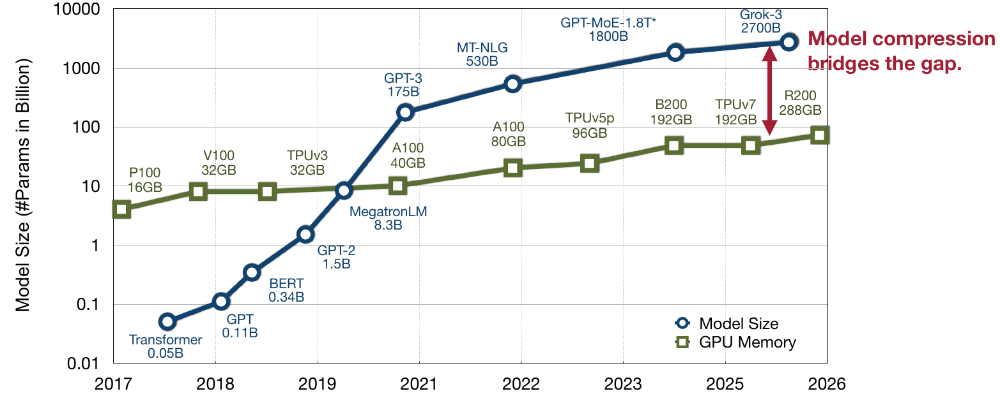

**AI is booming.** It is everywhere, and so is the increasing demand for model capacity and capability. Model sizes quickly started outpacing what the hardware could provide in terms of memory and compute. This trend doesn't seem to slow down. *With limited compute availability comes growing need for efficiency and cost-effectiveness.*

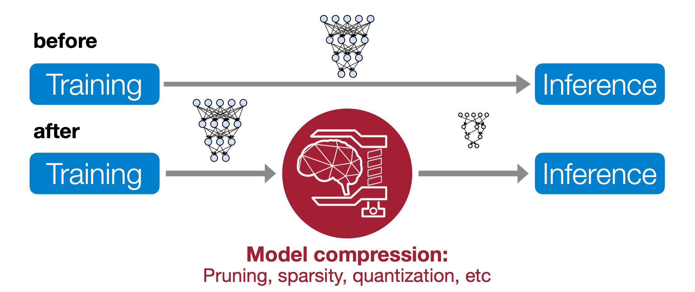

By the mid to late 2010s, training would traditionally immediately be followed by deployment and inference from the model. Nowadays, the scales of the models and the demand for them make this infeasible. Training now would be followed by phases of model compression, e.g., pruning, sparsity-related measures and quantization of the whole model or some of its components.

In AI, high accuracy comes at a cost of more MACs (Multiply-Accumulate Computations, $a\times b + c$).
**With efficient ML, we want higher accuracy for less computation.** In that sense, we target the top left corner to push the frontier of efficiency:

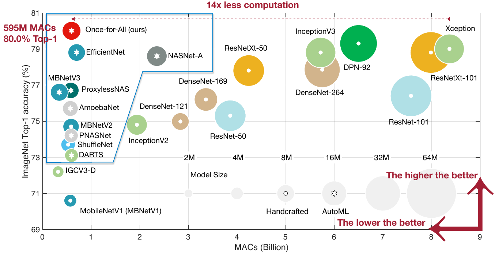 
*Source:* [\[Cai et al., 2020\]](https://arxiv.org/abs/1908.09791)

## What is Efficient ML?

Efficient ML is a growing field. Quite a few extremes have been pushed so far already. Local on-device deployments on smartphones and on tiny microcontrollers have become possible, running networks of just a few $100$ kilobytes. While these applications tend to mainly concern efficient inference, there is also the field of efficient local on-device training and fine-tuning, providing better privacy, lower cost, customizabiltiy and live-long learning.

>[!NOTE]
> Training and fine-tuning costs are $\sim 3\times$ higher than inference cost.

While training and fine-tuning are more intense, several different measures for efficiency can be combined, and their results can actually make a model orders of magnitude smaller and thus less compute-demanding:

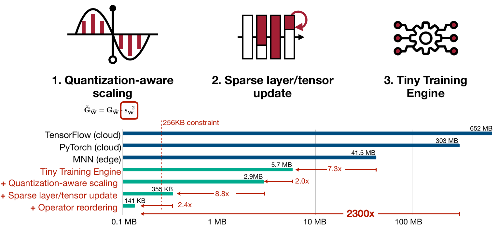

Efficiency measures can be combined and applied to entire networks, or just some of the (most expensive) components of ML systems. [EfficientViT](https://arxiv.org/abs/2205.14756) follows this latter idea, specifically altering only the Vision Transformer from the [Segment Anything](https://arxiv.org/abs/2304.02643) paper:

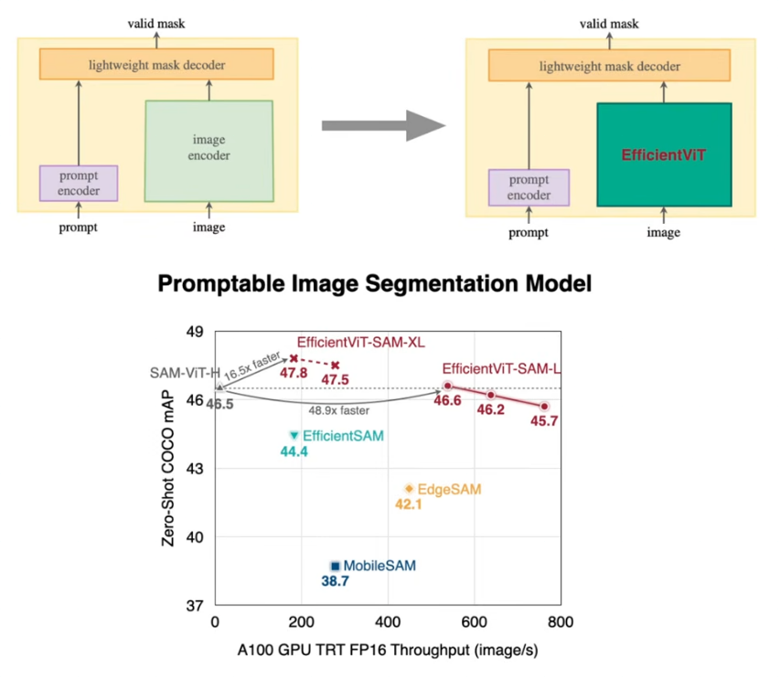 
*Sources:* [\[Kirillov et al., 2023\]](https://arxiv.org/abs/2304.02643), [\[Cai et al., 2023\]](https://arxiv.org/abs/2205.14756)

So far, we mentioned detection, classification and segmentation in the context of applying measures for efficient ML. For segmentation specifically, we just saw the ViT model component.
However, **generative models** are some of the most computationally demanding AI applications:

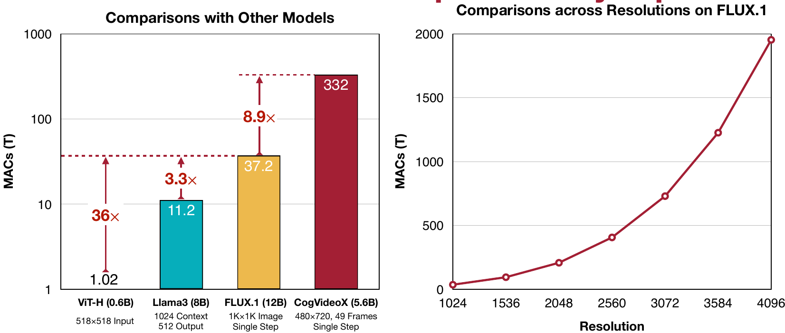 
*Sources:* [\[Dosovitskiy et al., 2021\]](https://arxiv.org/abs/2010.11929), [\[Yang et al., 2025\]](https://arxiv.org/abs/2408.06072) 

The way in which we access and utilize hardware as such is of concern as well for efficient ML. This goes into subfields like inference engineering, but more generally, we want to efficiently use the hardware we have, e.g. in a setting where we want to use multiple GPUs in parallel. Efficiency here means using hardware in combination in such a way that they can best be leveraged for a common output while reducing per-device load and minimizing overall latency:

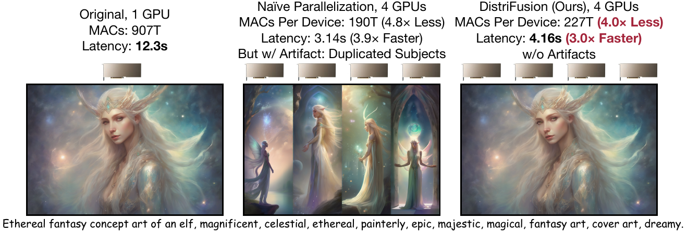

>[!NOTE]
> Wherever Deep Learning finds application, there probably also is room for efficiency gains to be leveraged. This can come in different shapes and levels, depending on what the task is (image/video classification, object detection, generative AI) or what the hardware is available (hardware may be the constraint or requires efficient orchestration to be leveraged cost-effectively).

*Generative models for text, image and video equally and heavily rely on the transformer architecture.* 
This reliance makes their complexity and demands for resources and compute grow quadratically with context length. Increasing model size for better capability worsens this effect accordingly.
Still, efficiency measures can be applied for the transformer and other generative approaches, like GANs (see [\[Lin et al., 2021\]](https://arxiv.org/abs/2103.03243)), as well.

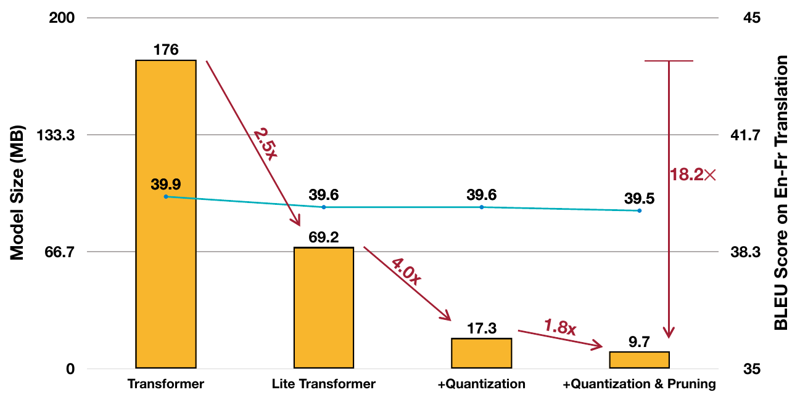 
*Source:* [\[Wu et al., 2020\]](https://arxiv.org/abs/2004.11886)

*When talking about generative AI, we have to talk about LLMs.* Plenty of options for efficiency gains exist here. To understand them, we have to understand how LLMs work. For example, as parameter counts in the LLMs grow quickly, their zero-shot, one-shot and few-shot capabilities grow slowly:

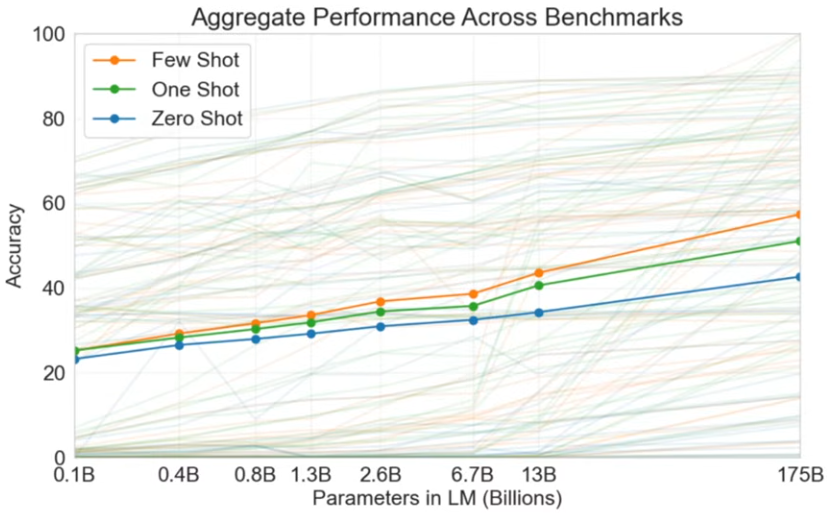 
*Source:* [\[Brown et al., 2020\]](https://arxiv.org/abs/2005.14165)

Add to that wanted but only costly achievable behavior the additional cost for more lengthy, extensive generations/outputs under the chain-of-thought paradigm. Where it earlier was sufficient to just generate the answer itself, now, a trail of thoughts upon which the answer ultimately builds upon has to be generated in before. Cost increases, yet so does model output quality.

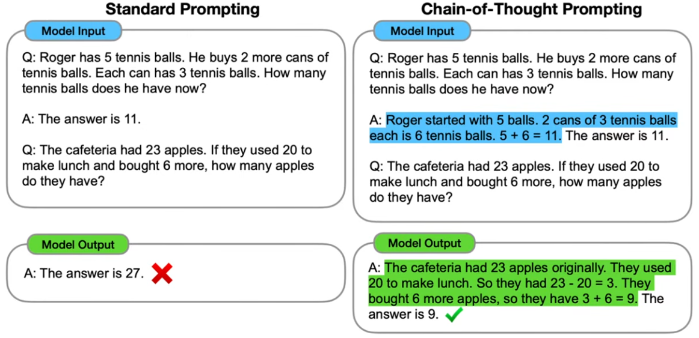 
*Source:* [\[Wei et al. 2022\]](https://arxiv.org/abs/2201.11903)

Just like with zero-, one- and few-shot learning, chain-of-thought not only costs at test-time, but it also demands the model to pretty much be large and capable enough to emerge as useful:

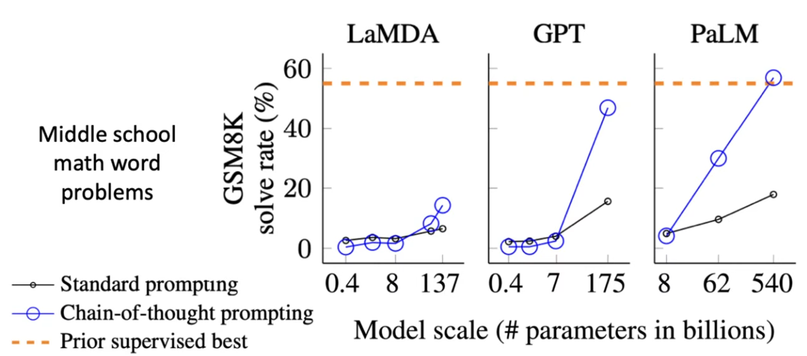 
*Source:* [\[Wei et al. 2022\]](https://arxiv.org/abs/2201.11903)

Contrary to that, it can be useful to deploy LLMs on the edge. We can achieve this by using *quantization* of the model's weights. Prominent examples are *SmoothQuant* and *AWQ.*

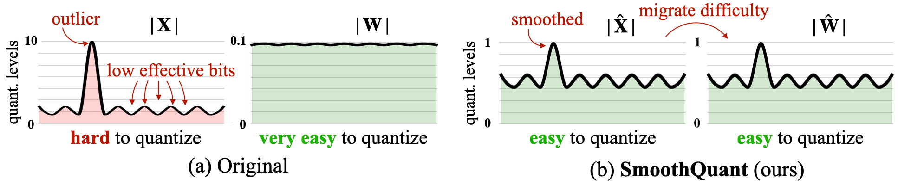 
*Source:* [\[Xiao et al., 2022\]](https://arxiv.org/abs/2211.10438)

*SmoothQuant* in particular is interesting because it was developed as a final project *from this course.*
Where prior approaches like AWQ would quantize the weights but not the activations produced from them, SmoothQuant quantizes both. This is particularly hard to pull off for activations, though, because they need to describe features, which may lead to them containing outliers. Having to consider such extreme values makes compression/quantization much less effective for activations. AWQ avoids facing this problem by leaving activations in FP16/BF16. SmoothQuant gets both weights and activations down to INT8 by deliberately scaling the activations per-input-channel so as to dampen the effects of outliers, while compensating for this scaling in the weights. (It uses a calibrated diagonal matrix $S$. The activation gets multiplied by $S^{−1}$, while the weights get multiplied by $S$. These products $X'$ and $S'$ can then *both* be quantized into INT8, replacing $X$ and $W$)

*Multimodal models can undergo weight quantization (and SmoothQuant) just as well.* Under the hood, language and vision-language models use the idea of tokenization. Where language models would only have to tokenize and work with text, vision-language models may additionally define tokens to represent information from patches of provided images.

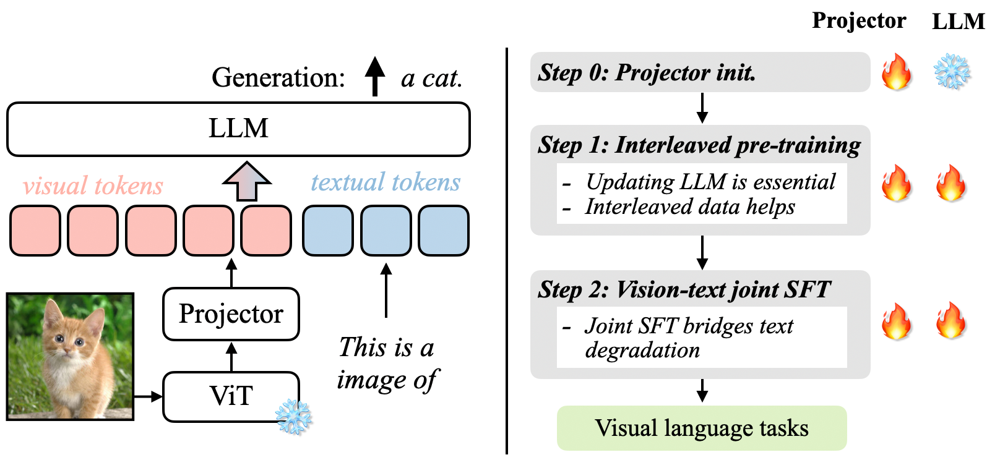

From tokenization onwards, all work is done in token embedding space, just like before. Therefore, the multimodal model architecture doesn't need to deviate from the language model architecture, meaning weight quantization can be applied here, too.

## The Three Pillars of Efficient Deep Learning

**Algorithm, Hardware and Data.**

Regarding ML algorithms, it turns out that software is the increasingly interesting contributor to advanced technology and technology improvements. It is the most costly factor to get right:

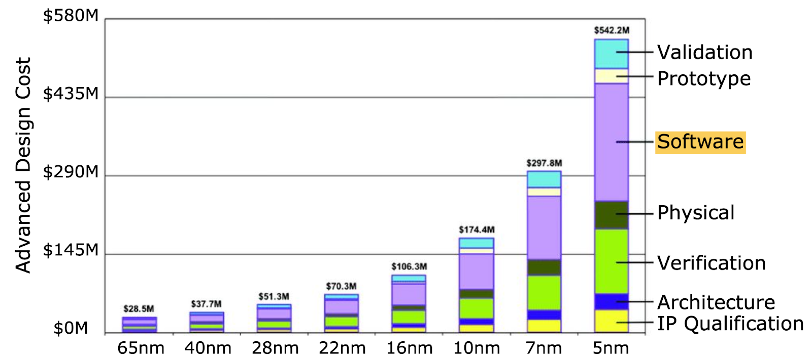 
*Source:* [\[Hruska, 2018\]](https://www.extremetech.com/computing/272096-3nm-process-node)

The software cost dominates the cost breakdown of advanced technology nodes

Hardware improves as well, just not as rapidly. Improvements concern available memory bandwidth, energy efficiency or TOPs. We have to differ between the application regimes: 
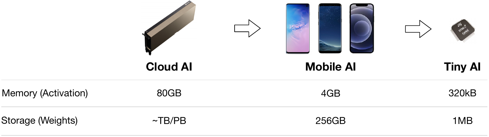

Demand for cloud compute has been on the rise, and cloud ai accelerators improve accordingly: 
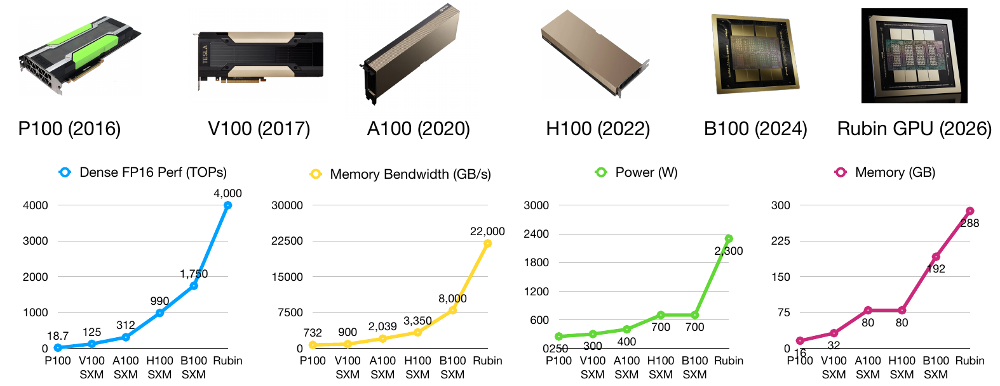

The trend is also observable in the smartphone and mobile devices regime: 
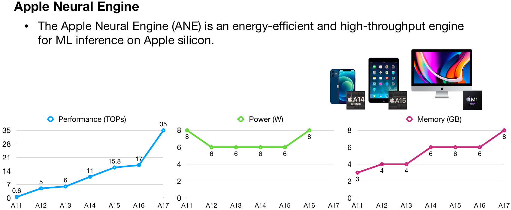

The capability increase as a development has also become observable in the edge hardware regime: 
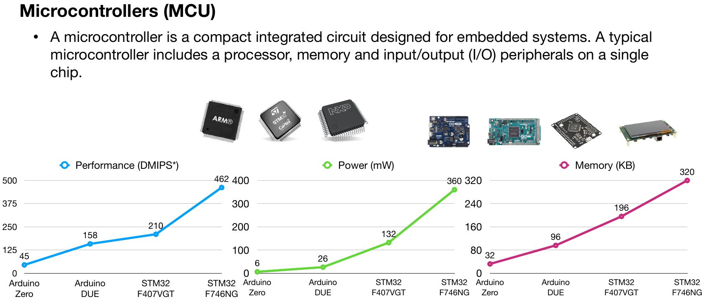

## Course Overview

The course is at the intersection of electrical engineering, general CS and AI and DL: 
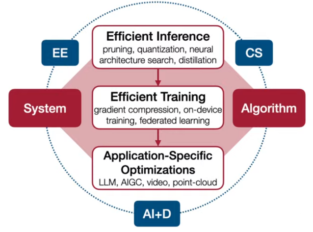

The Course Labs will be as follows: 
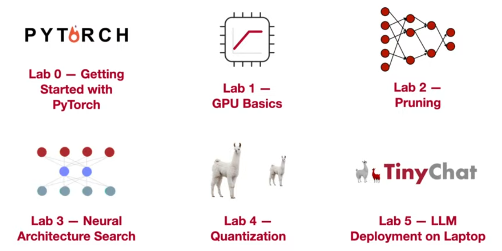

Some of the final projects from the last course:
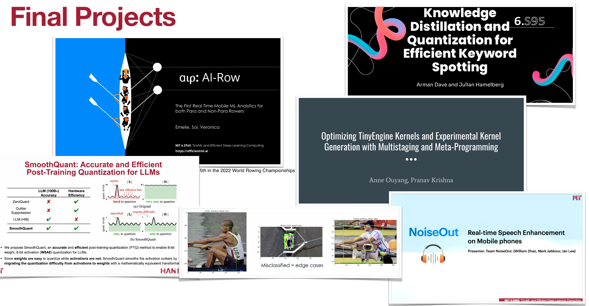

[SmoothQuant](https://arxiv.org/abs/2211.10438) in particular went on to become an industry-wide applied approach. But more on that later.

---

      Notes by <a href="https://github.com/MK2112">MK2112</a>

