# 02 - NN Basics

- [Neural Network Terminology Review](#neural-network-terminology-review)
- [Popular NN Building Blocks](#popular-nn-building-blocks)
    - [Convolutional Layer](#convolutional-layer)
        - [1D Convolutions](#1d-convolutions)
        - [2D Convolutions](#2d-convolutions)
        - [Padding](#padding)
        - [Strided Convolutions](#strided-convolutions)
        - [Grouped Convolutions](#grouped-convolutions)
        - [Depthwise and Pointwise Convolutions](#depthwise-and-pointwise-convolutions)
        - [Pooling](#pooling)
        - [Normalization](#normalization)
    - [Activation Functions / Nonlinearities](#activation-functions--nonlinearities)
    - [Transformer](#transformer)
- [Popular CNN Architectures](#popular-cnn-architectures)
    - [AlexNet (2012) and VGG-16 (2015)](#alexnet-2012-and-vgg-16-2015)
    - [ResNet-50 (2016)](#resnet-50-2016)
    - [MobileNetV2 (2018)](#mobilenetv2-2018)
- [Intro to Popular Efficiency Metrics](#intro-to-popular-efficiency-metrics)
    - [Details on Latency](#details-on-latency)
    - [Memory-Related](#memory-related)
        - [Parameter Count](#parameter-count)
        - [Model Size](#model-size)
        - [Total / Peak Number of Activations](#total--peak-number-of-activations)
    - [Computation-Related](#computation-related)
        - [MAC](#mac)
        - [FLOPs, FLOPS, OPs, OPS](#flops-flops-ops-ops)

The previous lecture established that there's a big gap between supply and demand of AI computing. 
Currently, model sizes outpace hardware capacities by quite some margin: 

>[!NOTE]
> This gap is still very much developing as we speak. We can bridge said gap with model compression and acceleration techniques to make more use of the limited hardware.

## Neural Network Terminology Review

**An output neuron is connected to all input neurons.** 
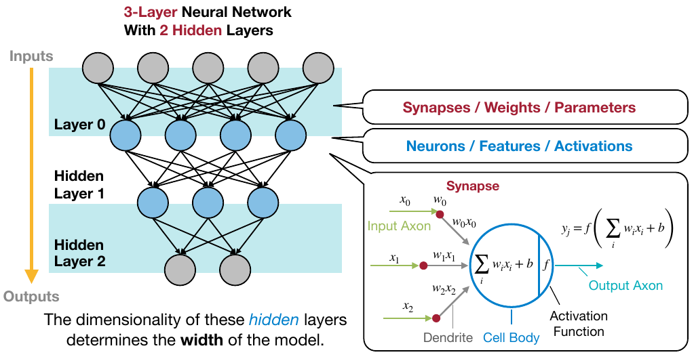

Given a set of input features $X$, shown here as grey dots of information. The features are fed into neurons, shown here with blue dots. The connections between the grey inputs and the blue neurons are weighted individually.

Suppose we called the grey dots $x_0, x_1, \dots, x_4$ from left to right. For each $x_i$, one connection goes to each neuron of layer 0. For $x_0$, that connection is called $w_0x_0$, which is a product of the information $x_0$ but weighted by a term $w_0$.

Now suppose we looked at a single blue dot / neuron from layer 0. It has four incoming connections, one from each $x_i$, each weighted by a respective term $w_i$. The neuron is now supposed to "do something with that", to form an output for the next deeper layer to process. The neuron formulates its output as:
$$y_j = f \left(\sum_iw_ix_i + b\right)$$
where we accumulate the weighted sum of all incoming connections and then add the bias term of layer 0 to that. This is then wrapped into function $f$, a non-linearity like Sigmoid or ReLU. The result is a single value $y_j$ for neuron $j$, which then can be passed along in the same fashion as before to the next deeper layer.

> [!CAUTION]
>**Question:** You could make a network wider and shallower or deeper and smaller. In other words, you could increase the amounts of neurons per layer and reduce the total layer count, or decrease the amount of neurons per layer while increasing the total layer count. **Which of these options is more efficient from a hardware perspective?**

> [!TIP]
>**Answer:** Wider but shallower networks would be easier on the hardware. The hardware is able to utilize parallelism much better with this configuration, whereas deeper layers would have to wait for data from shallower layers to accumulate in the second configuration.
>*However, deeper neural networks, usually bring more accuracy.*

The answer above hints at a fundamental concept of utilizing hardware parallelization. Under the hood, the calculations of neuron outputs are not done in quite the verbose fashion we formulated above. Instead, neuron outputs are calculated all at once (per layer) using matrix multiplication:

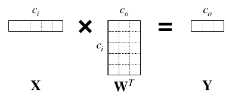

Once again $X$ denotes the set of features, now written as a *feature vector*. The vector contains $c_i$ many input values (the grey dots we saw for layer 0), where $c_i$ now denotes the amount of *input channels*, i.e. how many input features we have. The second matrix is the transposed weight matrix $W^T$.

In our example above, we saw the inputs connect to each neuron with one weighted connection each. The $c_o$ denotes the amount of *output channels*, i.e. the amount of neurons (the blue dots we saw for layer 0). As each of the $c_i$ input features (each grey dot) has to connect to each of the $c_0$ neurons (each blue dot) exactly once, we can formulate this as the matrix $W^T$ of shape $c_i \times c_o$. The output of that is $Y$, where each value $y_i$ in $Y$ denotes the weighted sum $y_i = \sum_{j}w_{ij}x_i$.

You can see that reformulating the calculation of neuron outputs to a matrix operation is one way of "parallelizing" computation. But this isn't the full story. Thanks to the matrix formulation, we can now perform *batching* quite easily. Batching allows for us to calculate the neuron outputs for $n$ many inputs not one input after another, but *at once:*

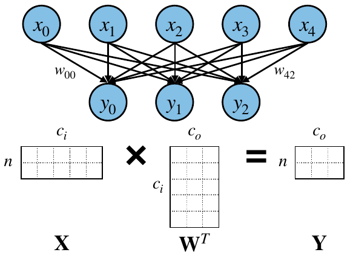

This works because stacking more input examples along the $n$ dimension does not change the channel dimensions, particularly $c_i$, and because $c_i$ is unaffected, we can just calculate a result like before, but now we accordingly get an output of shape $n \times c_0$.

## Popular NN Building Blocks

### Convolutional Layer

Given the above ideas, suppose we were to disconnect the direct connection between the input features and the output neuron, where each neuron would receive information from each input feature. *That's exactly what convolutional neural networks (CNNs) do.* With CNNs, the output neurons now only are connected to input neurons within a receptive field. This field is determined iteratively via a kernel.

In other words, to form a neuron's output, we now only provide it a subset of the input features, the receptive field, as determined and weighted by a kernel.

#### 1D Convolutions

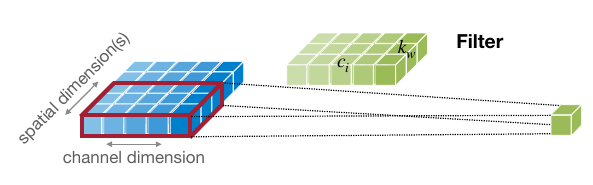

You can see our familiar term $c_i$ re-appear here. That's because in this configuration, the filter / kernel is as large in the channel dimension as the input itself. The difference occurs in the spatial dimension(s), where we only apply the filter for $k_w$ many dimensions.

Multiple filters / kernels can be applied consecutively to produce multiple such neuron outputs for one distinct receptive field: 
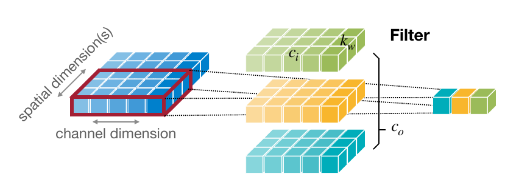

The key idea now is that you can apply multiple kernels to provide your output with "informational depth". But additionally, you can also now shift the receptive field of the kernel(s) across the input to re-apply the same kernels to a different part of the input, producing additional outputs.

Across strides of the kernel across the receptive field, weight sharing occurs: 
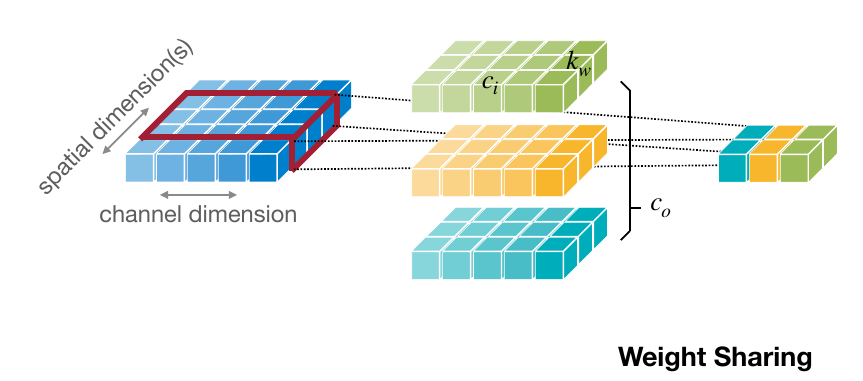

In total, convolutional neural networks fundamentally work with the following shape relations:

|                     | Fully-Connected Shapes                | 1D Convolutional Shapes                   |
| ------------------- | ------------------------------------- | ----------------------------------------- |
| Input Features $X$  | ($n,\ c_i$)                           | ($n,\ c_i,\ w_i$) ($w_i$: width input)    |
| Output Features $Y$ | ($n,\ c_o$)                           | ($n,\ c_o,\ w_o$) ($w_o$: width output)   |
| Weights $W$         | ($c_o,\ c_i$)                         | ($c_o,\ c_i,\ k_w$) ($k_w$: kernel width) |
| Bias $b$            | $c_o$ (one bias parameter per kernel) | $c_o$ (amount of different kernels)       |

Althought the above example processed a 2D input with 2D kernels, it did so in a way that had the receptive field move only along the spatial dimension(s) axis, i.e., only along one dimension. That is why **the above example applied 1D convolutions in 2D space.**

#### 2D Convolutions

The convolutional network ideas we just encountered for the 2D space can easily be projected into 3D space as well: 
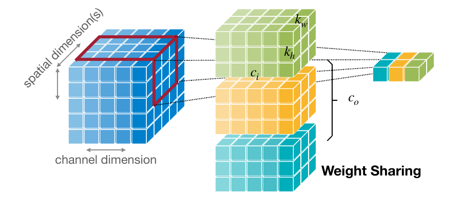 
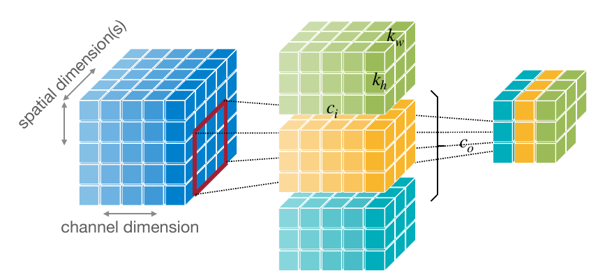

And, you guessed it, here we move the kernels only along the two spatial dimensions. Hence, **this example applies 2D convolutions in 3D space.**

|                     | Fully-Connected Shapes            | 1D Convolutional Shapes                       | 2D Convolutional Shapes                                          |
| ------------------- | --------------------------------- | --------------------------------------------- | ---------------------------------------------------------------- |
| Input Features $X$  | ($n,\ c_i$)                       | ($n,\ c_i,\ w_i$) ($w_i$: width input)     | ($n,\ c_i,\ h_i,\ w_i$) ($h_i$: height input)                 |
| Output Features $Y$ | ($n,\ c_o$)                       | ($n,\ c_o,\ w_o$) ($w_o$: width output)    | ($n,\ c_o,\ h_o,\ w_o$) ($h_o$: height output)                |
| Weights $W$         | ($c_o,\ c_i$)                     | ($c_o,\ c_i,\ k_w$)  ($k_w$: kernel width) | ($c_o,\ c_i,\ k_h,\ k_w$) ($k_h,\ k_w$: kernel height, width) |
| Bias $b$            | $c_o$ (one bias param per kernel) | $c_o$ (again, one bias param per kernel)      | $c_o$ (and again, one bias param per kernel)                     |

We can calculate the height of the output feature map via $h_o = h_i - k_h + 1$: 
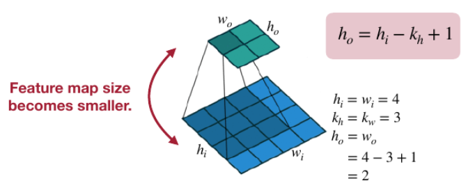 
*Source:* [\[Dumoulin and Visin, 2016\]](https://arxiv.org/abs/1603.07285) via [GitHub](https://github.com/vdumoulin/conv_arithmetic)

We can put the above observation into two expressions: 
If $k_h,k_w>1$ and the stride $s=1$, then $w_o=w_i-k_w+1<w_i,\ h_o=h_i-k_h+1<h_i$. 
Likewise, if $k_h=k_w=1$ and the stride $s=1$, then $w_o=w_i,\ h_o=h_i$.

In other words, applying a kernel to an input has us at best retain the input's height and width for the output, but we can never produce outputs larger than the inputs. 

*Or can we?*

#### Padding

Padding can be used to keep the output feature map the same as the input feature map at kernel sizes $\gt 1$. Alternatively, padding can also be taken to an extreme to produce an output with width and height larger than the original input. This is achieved by **adding information around the actual input feature map.** 

Different padding techniques exist: 
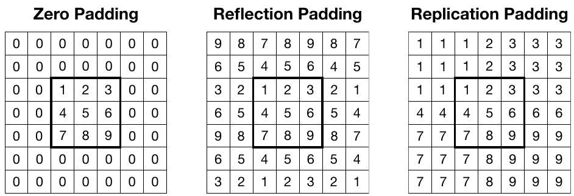

The kernel then is exposed to the padded input. The amount of output neurons increases as the padding artificially expands the amount of times we have to apply the kernel's receptive field.

This can be formulated like so ($p$ expresses the 'thickness' of the boundary added around the input):
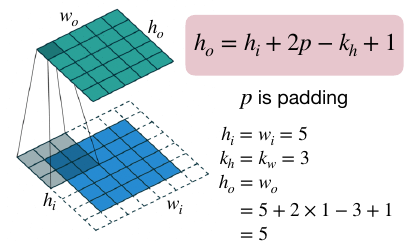 
*Source:* [\[Dumoulin and Visin, 2016\]](https://arxiv.org/abs/1603.07285) via [GitHub](https://github.com/vdumoulin/conv_arithmetic)

After applying padding, the output's size is now equal to the inputs size, even though we used a $3\times 3$ kernel (see the gray shadow on the input, that's the kernel).

CNNs are very popular for image processing. We can pretty easily apply the terminology from CNNs to images as input, as they too have a height, width and a depth through the three pixel-wise RGB color values. For the next example, suppose we provide an image as input to the CNN.

**CNNs output information in a way that manifests translational equivariance.** This means that the more layers the CNN has, the less the position of a distinct object within an image matters.

This is a core reason for why we want an initially large receptive field in the CNN, as it helps providing deeper layers with more richness in information. 
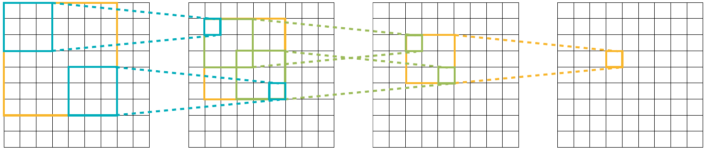 
*Took inspiration from:* [CS231N Lecture 5 by Ruohan Gao, Slides 92 and 93](https://cs231n.stanford.edu/slides/2022/lecture_5_ruohan.pdf)

Suppose a CNN with $L$ many layers. Further suppose we have a quadratic kernel (e.g. $3\times 3$, $5\times 5$ in width and height), and we can express that kernel's size by just one single parameter $k$ (where $k = 3$ expresses both kernel width and height of $3$). Then we can calulate the receptive field size like so:
$$L \cdot (k-1) + 1$$
For the above example, in a CNN with kernels $k=3$ applied over layers $L=3$ a single unit of information (a single pixel) at layer $3$ is affected by a receptive field of width and height $3 \cdot (3 - 1) + 1 = 7$ in layer $0$.

>[!NOTE]
> In order to meaningfully process large receptive fields, or large input images, we need very deep CNNs. This of course becomes expensive and demanding for the hardware. So, we need to apply tricks to downsample. One such trick is the strided convolution.

#### Strided Convolutions

To increase the receptive field of an output neuron in a cheap way, one option would be to increase the kernel stride. **The stride refers to the step size between different receptive fields, i.e. how far we move the kernel over the input.** Until now, we only ever saw $stride = 1$ applications, where we would move the kernel further by one pixel before re-applying it. But what about increasing this stride, as done with **strided convolutions** and pushed to an extreme with **dilated convolutions**?

This is an animated example with $padding = 0$ and $stride = 2$: 
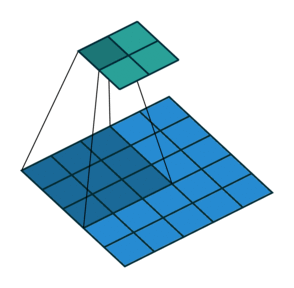 
*Source:* [\[Dumoulin and Visin, 2016\]](https://arxiv.org/abs/1603.07285) via [GitHub](https://github.com/vdumoulin/conv_arithmetic)

Applying a $\text{stride} \gt 1$ also changes the formula for how to calculate $h_o$ like so: 
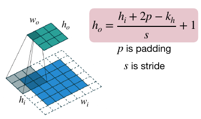 
*Source:* [\[Dumoulin and Visin, 2016\]](https://arxiv.org/abs/1603.07285) via [GitHub](https://github.com/vdumoulin/conv_arithmetic)

Coming back to our initial problem and the reason for why we introduced strided convolutions in the first place, *increasing the stride helps covering a larger receptive field with the same amount of operations*. Because of that, the number of layers of a CNN may remain unchanged, yet its exposure to the image may still improve, as deeper layers profit more from the now increased receptive field.

However, because we cover the images with increased strides, this may cover the image contents also more coarsely. This, may dampen the accuracy boost one might expect from strided convolutions.

There is no free lunch, strided convolutions may hit their limits earlier than one would be led on to suggest, but this is also the reason for many more optimizations and techniques for improved CNN performance beyond just increasing the stride.

#### Grouped Convolutions

With the default CNN as discussed until now, we saw that the output neurons, through the kernel, get related to the entire input feature map: 
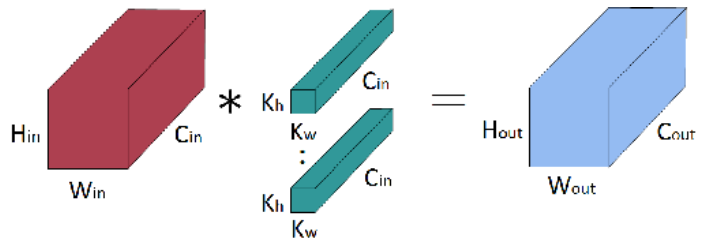 
*Source:* [\[Gibson et al., 2020\]](https://www.research.ed.ac.uk/en/publications/optimizing-grouped-convolutions-on-edge-devices/)

To reduce the operations we apply across this set of kernels we can just half the kernels range of application across the input's feature channels. As the amount of units of information per such group is now smaller, the size per kernel can become smaller too.
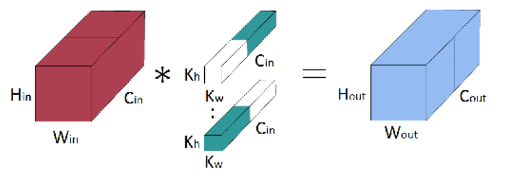 
*Source:* [\[Gibson et al., 2020\]](https://www.research.ed.ac.uk/en/publications/optimizing-grouped-convolutions-on-edge-devices/)

Grouped Convolutions effectively reduce the total amount of processed weights from $(c_o,\ c_i,\ k_h,\ k_w)$ to $(g\cdot c_o/g, c_i/g, k_h, k_w)$.

#### Depthwise and Pointwise Convolutions

Depthwise and pointwise convolutions can be understood as two extreme forms of the grouped convolution approach. 

Where standard kernels would cover a certain width and height for the receptive field and then some amount of $M$ channels from the input feature map, *depthwise convolutions only ever concern one channel alone per application (width and height $\geq 1$, only $1$ channel).* Conversely, *pointwise convolutions only ever concern all channels of one single pixel (width and height 1, all $M$ channels)*

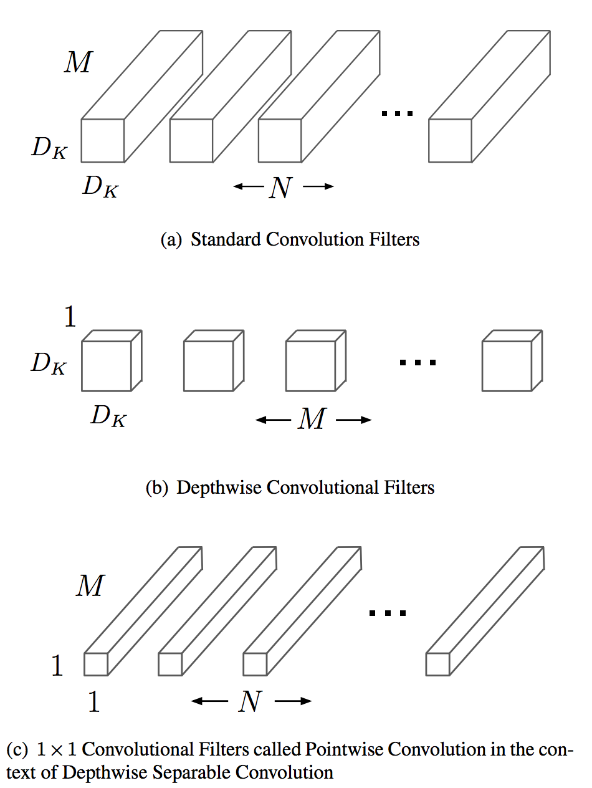 
*Source:* [ikhlestov.github.io](https://ikhlestov.github.io/pages/machine-learning/convolutions-types/)

Both are quite widely used techniques especially due to the MobileNetV2 and MobileNetV3 architectures relying on them for efficiency.

#### Pooling

*Pooling reduces the feature space for further processing* in a way that is efficient, fast, and doesn't require training. Max Pooling is the most prominent variant. It retains only the highest value of some filter scope, while average pooling calculates and then retains the average of said scope:

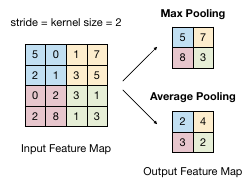 
*Took inspiration from:* [CS231N Lecture 5 by Ruohan Gao, Slides 108 and 109](https://cs231n.stanford.edu/slides/2022/lecture_5_ruohan.pdf)

Pooling applies its own pooling kernel, which a size and stride. In the above image, a $2\times 2$ kernel with stride $2$ gets applied.

#### Normalization

Suppose you have an input to a layer of your network where the input features are vastly different from one another. *Applying normalization to these features often makes optimization faster, and can improve robustness and generalizability in practice.*

Multiple different normalization techniques exist: 
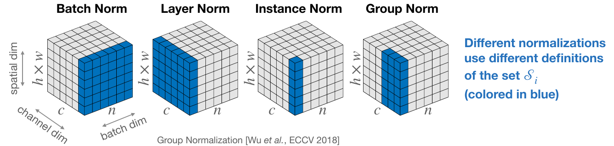 
*Source:* [\[Wu et al., 2018\]](https://arxiv.org/abs/1803.08494)

These *versions differ in their scope of the normalization's application*.
The normalization itself, across the set of selected values $\mathcal{S}_i$, looks like this:

$$\hat{x}_i = \frac{1}{\sigma_{\mathcal{S}_{i}}} \left( x_i - \mu_{\mathcal{S}_{i}}\right)$$

where $\mu$ is the mean and $\sigma$ is the standard deviation over $\mathcal{S}_i$. 

$$\mu_{\mathcal{S}_i} = \frac{1}{m} \sum_{k \in \mathcal{S}_i}x_k$$

$$\sigma_{\mathcal{S}_i} = \sqrt{\frac{1}{m}\sum_{k\in \mathcal{S}_i} \left(x_k - \mu_{\mathcal{S}_i} \right)^2 + \epsilon}$$

Depending on the method (batch, layer, instance, group) the normalization statistics are calculated for different $\mathcal{S}_i$. Afterwards, in any case, a learned affine transformation is applied, typically parameterized per feature or per channel. This learnable transformation on top of the statistics ultimately provides the new values.

*We formulate the according linear transform like so:*

$$y = \gamma \cdot \hat{x}+\beta$$

where both $\gamma$ and $\beta$ are learnable. $\hat{x}$ itself is just $x$ with the normalization statistics already applied to it.

- *Batch Normalization:* $\gamma$, $\beta$ are learnable *per channel* of $\hat{x}$
- *Layer Normalization:* $\gamma$, $\beta$ are learnable *per entry* in the batch (per image)
- *Instance Normalization:* $\gamma$, $\beta$ are learnable *per channel and per entry* in the batch
- *Group Normalization:* $\gamma$, $\beta$ are learnable *per specified group of channels per entry* in the batch 

### Activation Functions / Nonlinearities

Even with identical architectures, neural networks may yield different outputs and training behaviors when they employ different activation functions.

Some very widely applied activation functions are shown below: 
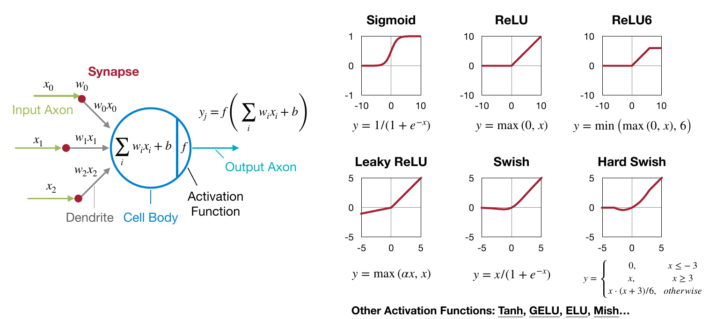

>[!NOTE]
>If neuron outputs fall into the flat regions of an activation function (prominently seen with *Sigmoid* and *ReLU*, for example), *gradients become negligible or vanish entirely.* As a result, learning stalls, as backpropagation cannot effectively update the model parameters.
>On the other hand, unrestricted activation value ranges, we will we, will be harder to make efficient, as the scale to which we can quantize is not cleanly predictable and we have to account for potential extremes.

This problem of simple yet regionally unexpressive non-linearities caused alternatives like *LeakyReLU* to emerge. It can provide some non-zero gradient at any of its points.

*Swish* is a smoother activation function that provides non-zero gradients across a wider range. While this can potentially improve optimization, it also is more computationally expensive. For a more efficient approximation, *Hard Swish* can be used.

### Transformer

The Transformer architecture is essential for the current developments in NLP, but also AI more generally. It consists of two main parts: The encoder and the decoder. Each part is made up of several, repeatable layer stacks. Each layer may allow for different optimizations.

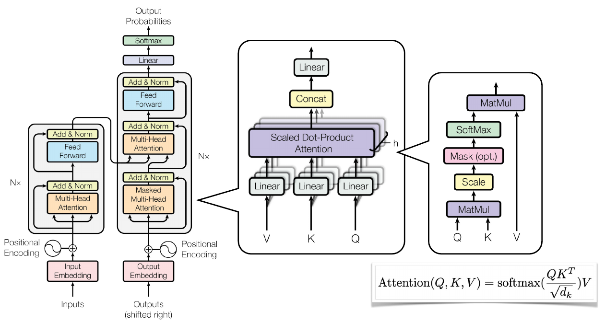 
*Source:* [\[Vaswani et al. 2017\]](https://arxiv.org/abs/1706.03762)

This image successively unravels the transformer's *Multi-Head Attention* component. The attention mechanism enables a transformer to examine a sequence and assign learnable weights to the relationships between its elements.

**At a high level:**
- The Query $Q$ expresses *what it is that we are looking for*
- The Key $K$ is what $Q$ is compared against to *determine informational relevance through similarity*
- The Value $V$ is the *informational content that gets scaled* according to those similarity scores

$Q$, $K$ and $V$ are matrices made up of vectors $q$, $k$ and $v$ respectively.
To determine in what ways $V$ is important to $Q$, we let $Q$ interact with $K$:
$$\text{softmax}\left(\frac{QK^T}{\sqrt{d_k}}\right)$$
This provides us with the scaling factors by which we can then express how important each entry in $V$ is for our $Q$. In other words, these scaling factors express the attention we give to the entries in $V$.
Note that we use the term $\sqrt{d_k}$ , where $d_k$ is the dimensionality of a vector $k$ inside $K$ (or $q$ inside $Q$, identical) to help stabilize the behavior of $\text{softmax}$ for better optimization)

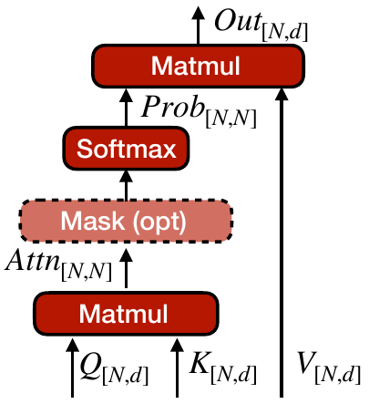

With the image above, we can see that the steps of calculating the attention weights form an $N\times N$ matrix $Prob$, with $N$ being the sequence length, i.e. the amount of vectors $q$ in $Q$ or $k$ in $K$ respectively.

>[!NOTE]
> The attention mechanism's complexity scales quadratically w.r.t. the sequence length: $O(N^2)$

## Popular CNN Architectures

### AlexNet (2012) and VGG-16 (2015)

**For AlexNet:** Input is a $224\times 224\times 3$ image. The first network component is a large $11\times 11$ convolution that has quite a high stride and produces quite a lot of channels. This may look weird now, and very sudden, but the big stride in the beginning is put there so as to quickly reduce the activation size by at this point a quadratic factor, in order to meaningfully save GPU memory. Output layer is $1000$ as it aims to produce a class distribution prediction across $1000$ classes.

**For VGG-16:** Looking at this network architecture (see below) it looks more organized and more repetitive. It's also a lot bigger than AlexNet, at 16 layers.
But the regularity introduced here is something we will grow to like later on, because it offers leverage for us to make he network operate more efficiently.

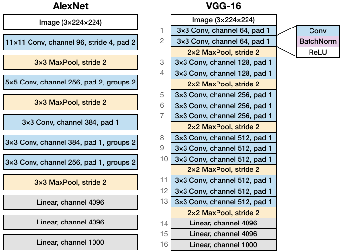 
*Sources:* [\[Krizhevsky et al., 2012\]](https://proceedings.neurips.cc/paper_files/paper/2012/file/c399862d3b9d6b76c8436e924a68c45b-Paper.pdf), [\[Simonyan et al., 2015\]](https://arxiv.org/abs/1409.1556)

### ResNet-50 (2016)

ResNet-50 became a yet again much deeper network. It achieved this because it addressed a particular chokepoint in its architecture: gradient propagation facilitated back even into the shallowest layers using residual connections.

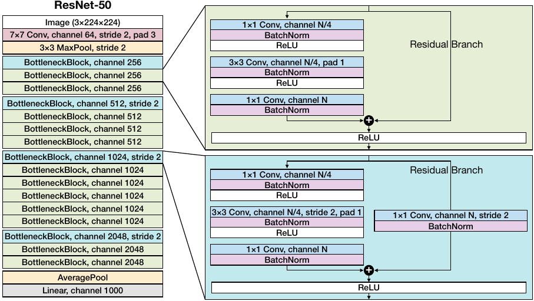 
*Source:* [\[He et al., 2016\]](https://openaccess.thecvf.com/content_cvpr_2016/html/He_Deep_Residual_Learning_CVPR_2016_paper.html)

You can see two residual connection constructions here. In the upper one (green background) the input and output channel counts for the residual block match. In the lower one (blue background) this is not the case, and we have to apply a convolution distinctly only to the residual branch to bring it into the target shape as well.

At this point, depth became more feasible. This now grew demands for efficency. One of the early and very accomplished efficient image processing network architectures was *MobileNetV2.*

### MobileNetV2 (2018)

The standard convolution operation can be split into a depth-wise convolution and a $1\times 1$ convolution. Google applied this in MobileNetV2 very successfully within the residual blocks to save compute and make it possible for such a network to run even on smartphones.

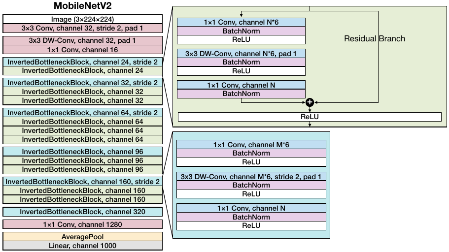 
*Source:* [\[Sandler et al., 2018\]](https://arxiv.org/abs/1801.04381)

## Intro to Popular Efficiency Metrics

**Ideally, we want our optimizations to improve along the axes of Latency, Energy and Storage.**

We generally rely on *two realms of metrics* to measure the impact along these dimensions:
- Model-related efficiency metrics (parameter counts, total activations, peak activations, ...)
- Computation-related efficiency metrics (MACs, FLOPS, Operations per second, ...)

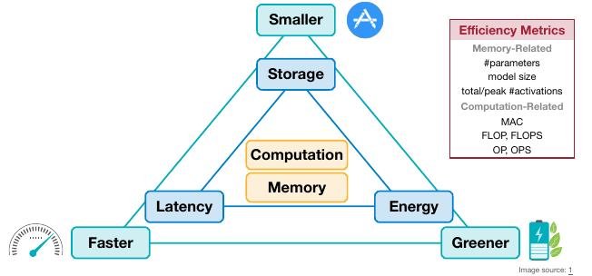

**Regarding both computation and memory, we have to consider:**
- *Latency:* Measures the time used for solving a specific task
- *Throughput:* Measures the rate at which data is processed

*Higher throughput may not automatically translate to lower latency, and vice versa.*
For example, concurrency can allow for *higher* latency (per image) at *higher* throughput (alltogether):

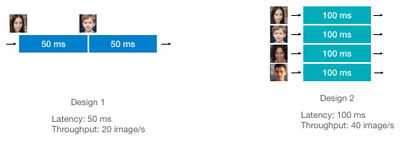

### Details on Latency

A model's latency is goverened either by *how fast we compute* or *how fast we can move data* for it:
$$\textit{Latency} \approx \max{\left(T_{computation}, T_{memory}\right)}$$
($T_{computation}$ concerns the arithmetic, $T_{memory}$ is all about data movement)

How fast we compute *depends on the network's trainable parameter structures* as well as the *available hardware capabilities:* $$T_{computation} \approx \frac{\text{Number of Operations in Neural Network Model}}{\text{Number of Operations the Processor can Process Per Second}}$$*How fast we can move necessary data* is determined by a sum of loading the weights from memory and then moving intermediate results between them: $$T_{memory} \approx T_{\textit{data movement of activations}} + T_{\textit{data movement of weights}}$$
*How fast we can load the weights from memory* depends on the model size (not only the trainable parameter structures) and the memory bandwidth:
$$T_{\textit{data movement of weights}} \approx \frac{\text{Neural Network Model Size}}{\text{Memory Bandwidth of Processor}} $$
*How fast we can move intermediate results between the weights* depends on the size of activations to be read from memory (input) and then written back to memory (output), as well as,, again, the memory bandwidth available for that:
$$T_{\textit{data movement of activations}} \approx \frac{\text{Input Activation Size + Output Activation Size}}{\text{Memory Bandwidth of Processor}}$$

**Data movement requires more memory references, which in turn requires more energy. Computation is comparably cheap, while memory movement consumes energy and time:**

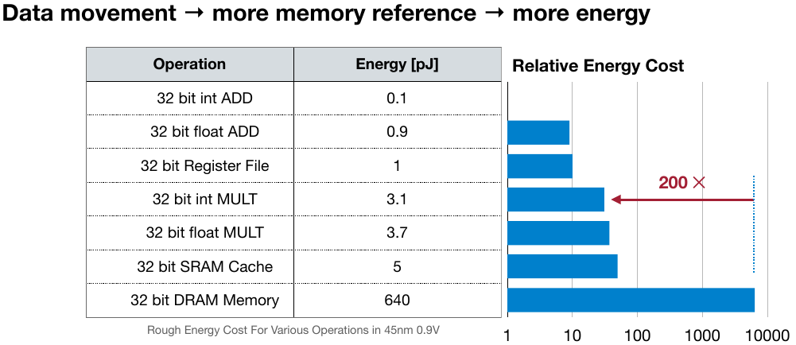 
*Source:* [\[Horowitz, M., 2014\]](https://gwern.net/doc/cs/hardware/2014-horowitz-2.pdf)

>[!CAUTION]
> **Question:** Why is it that we explain latency w.r.t. the processor's memory bandwidth? Doesn't that invalidate the claim that throughput and latency do not translate?

>[!TIP]
>**Answer:** The memory bandwidth imposes a bottleneck on *both* the per-request time (latency) *and* the system capacity (throughput). Crucially, memory bandwidth is just a shared bottleneck that independently affects both latency *and* throughput.
>
>*Think of a highway:*
>- *The time it takes* for one car to travel from entrance to exit reflects the *latency*
>- *The amount of cars* that pass a point on the highway per second reflect the *throughput*
>- The amount of lanes the highway has reflects the *memory bandwidth*
>
> Even though both can be constrained by the same hardware limits, latency and throughput measure different aspects of performance.

### Memory-Related

#### Parameter Count

The number of parameters is the weight count of the given neural network, i.e., the number of elements in the weight tensors.

| Symbol(s)   | Meaning               |
| ----------- | --------------------- |
| $n$         | Batch Size            |
| $c_i$       | Input Channel Count   |
| $c_o$       | Output Channel Count  |
| $h_i,\ h_o$ | Input / Output Height |
| $w_i,\ w_o$ | Input / Output Width  |
| $k_h,\ k_w$ | Kernel Height / Width |
| $g$         | Group                 |

| Layer                                    | \#Parameters                                                                                     | Visualization                                                                                         |
| ---------------------------------------- | ------------------------------------------------------------------------------------------------ | ----------------------------------------------------------------------------------------------------- |
| Linear Layer                             | $c_o \cdot c_i$                                                                                  |  |
| Convolution                              | $c_o \cdot c_i \cdot k_h \cdot k_w$                                                              | 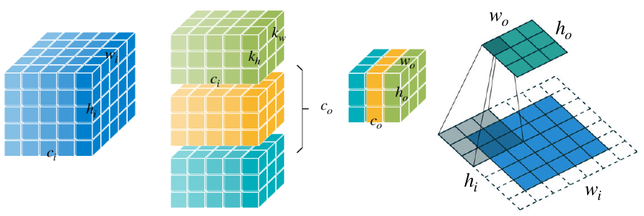   |
| Grouped Convolution ($g$ many groups) | $c_o / g \cdot c_i / g \cdot k_h \cdot k_w \cdot g$ $= c_o \cdot c_i \cdot k_h \cdot k_w / g$ |        |
| Depthwise Convolution                    | $c_o \cdot 1 \cdot k_h \cdot k_w$                                                                | 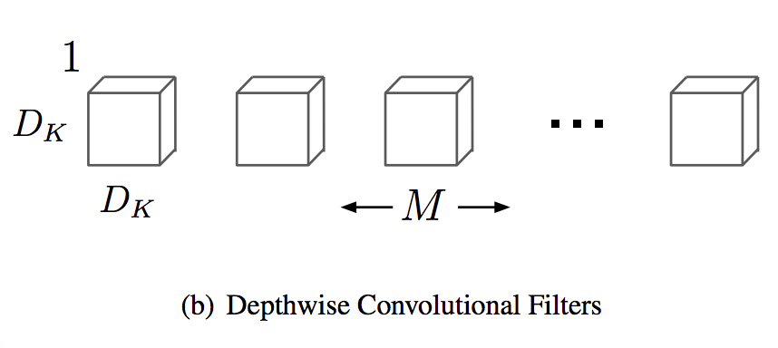          |

For example, counting the 61M parameters of AlexNet looks like so: 
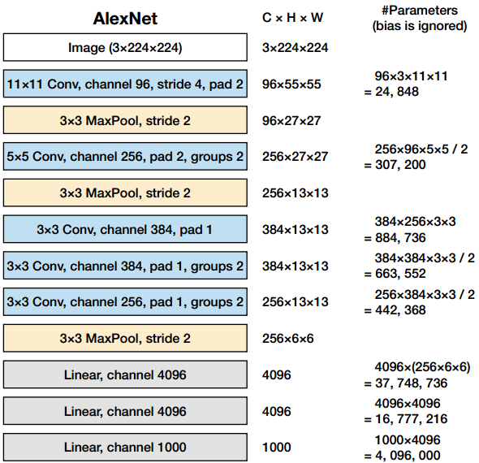 
*Source:* [\[Krizhevsky et al., 2012\]](https://proceedings.neurips.cc/paper_files/paper/2012/file/c399862d3b9d6b76c8436e924a68c45b-Paper.pdf)

#### Model Size

>[!NOTE]
> The model size measures the storage for the weights of the given neural network.

If the whole neural network uses the same data type (e.g., floating-point), then:
$$\text{Model Size} = \text{Number of Parameters} \cdot \text{Bit Width}$$
AlexNet has 61M parameters.  If all weights are stored with 32-bit numbers, total storage will be about
$$61\ \text{M} \times 4\ \text{Bytes} = 244\ \text{MB}$$
If we were to map the information from these parameters nicely into $8$-bit representations, we could effectively reduce memory demands:
$$61\ \text{M}\ \times 1\ \text{Byte} = 61\ \text{MB}$$
This would both affect storage and inference speeds.

#### Total / Peak Number of Activations

**$\text{Number of Activations}$ is the memory bottleneck in CNN <u><b>inference</b></u>, not $\text{Number of Parameters}$.**

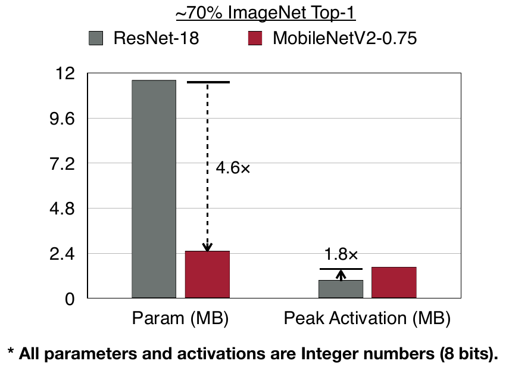 
*Source:* [\[Lin et al., 2020\]](https://proceedings.neurips.cc/paper/2020/hash/86c51678350f656dcc7f490a43946ee5-Abstract.html)

For CNNs, the amount of activation is a large set of intermediate results that must be repeatedly read and written across layers, whereas parameters themselves, i.e., the kernels, are reused. The deeper the CNN, the more data on activations has to be moved through the memory for the forward pass.

Depending on whether we use larger or smaller kernels, pooling or padding, smaller or larger amounts of activations may be produced at once. **The peak activation refers to the largest activation memory footprint required at any step of execution during the forward pass.**

>[!NOTE]
> For CNNs, peak activation determines the *maximum memory required* at any point during execution, and therefore sets the *minimum memory capacity needed* to run the model.

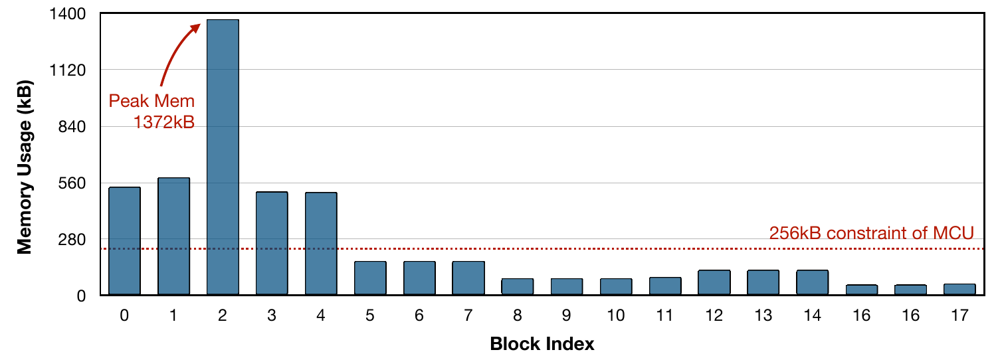 
*Source:* [\[Lin et al., 2020\]](https://proceedings.neurips.cc/paper/2020/hash/86c51678350f656dcc7f490a43946ee5-Abstract.html)

The uneven memory distribution shown here for MobileNetV2 is pretty common in CNNs. Early layers encounter high-resolution feature maps, e.g., an image with pixel-by-pixel information. Deeper layers progressively downsample and thus operate on increasingly smaller representations.

**$\text{Number of Activations}$ is the memory bottleneck in CNN <b><u>training</u></b>, not $\text{Number of Parameters}$.** This is mostly caused by the batch size.

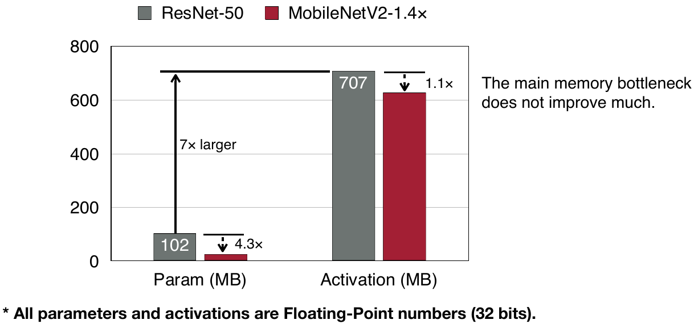 
*Source:* [\[Lin et al., 2020\]](https://proceedings.neurips.cc/paper/2020/hash/86c51678350f656dcc7f490a43946ee5-Abstract.html)

Plotting out the activation memory and the weight memory across layers for MobileNetV2, we find that *shallow network layers have a higher demand for activation memory,* while *deeper layers demand more memory for the weights themselves.* 

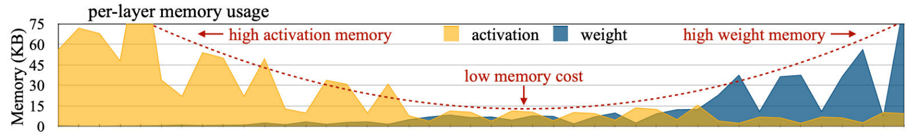 
*Source:* [\[Lin et al., 2020\]](https://proceedings.neurips.cc/paper/2020/hash/86c51678350f656dcc7f490a43946ee5-Abstract.html)

Shallow layers operate on high spatial resolution, while deeper layers trade this spatial size in favor of more channels. This increases the channel-wise computation and usage of distinct weights.

For AlexNet, the peak activation can be found by first calculating the activations via the formula $C \times H \times W$ for each layer, and then finding the layer with the highest $\approx \text{Number of Input Activations} + \text{Number of Output Activations}$:

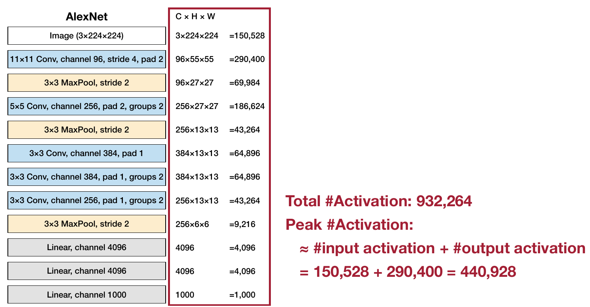 
*Source:* [\[Krizhevsky et al., 2012\]](https://proceedings.neurips.cc/paper_files/paper/2012/file/c399862d3b9d6b76c8436e924a68c45b-Paper.pdf)

### Computation-Related

#### MAC

One MAC represents a **M**ultiply-**Ac**cumulate Operation $a \leftarrow a + b \cdot c$ , which happens to be represented as single instruction in GPU logic.

For *Matrix-Vector Multiplication,* we find that $\text{MACs} = m \cdot n$

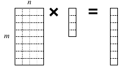

Then, for *Matrix-Matrix Multiplication,* we find that $\text{MACs} = m \cdot n \cdot k$ 
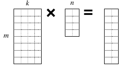

To understand the network building block-related ways of calculating their MACs, we should first remind ourselves of the notation used before.

| Symbol(s)   | Meaning               |
| ----------- | --------------------- |
| $n$         | Batch Size            |
| $c_i$       | Input Channel Count   |
| $c_o$       | Output Channel Count  |
| $h_i,\ h_o$ | Input / Output Height |
| $w_i,\ w_o$ | Input / Output Width  |
| $k_h,\ k_w$ | Kernel Height / Width |
| $g$         | Group                 |

| Layer (ignoring bias) | MACs (batch size = 1)                                  | Visualization                                                        |
| ------------------------ | --------------------------------------------------------- | -------------------------------------------------------------------- |
| Linear Layer             | $c_o \cdot c_i$                                           |  |
| Convolution              | $c_i \cdot k_h \cdot k_w \cdot h_o \cdot w_o \cdot c_o$   |    |
| Grouped Convolution      | $c_i/g \cdot k_h \cdot k_w \cdot h_o \cdot w_o \cdot c_o$ |        |
| Depthwise Convolution    | $k_h \cdot k_w \cdot h_o \cdot w_o \cdot c_o$             |           |

>[!CAUTION]
>**Question:** Why do we calculate the MACs through $c_i \cdot k_h \cdot k_w \cdot h_o \cdot w_o \cdot c_o$ for a convolutional layer?

>[!TIP]
>**Answer:** There are $h_o \cdot w_o \cdot c_o$ many positions in the output that we need to calculate. For each output position, per output channel, we would apply the kernel across all input channels, which is $c_i \cdot k_h \cdot k_w$ many multiplications that accumulate for the output, i.e., MACs.

#### FLOPs, FLOPS, OPs, OPS

A $\text{FLOP}$ is a **floating point operation.**
This may be an addition, *or* a multiplication.
Since this is the case, we can say that $1\ \text{MAC} = 2\ \text{FLOPs}$ .

There exists a relationship between $\text{FLOPs}$ (floating point operations) and $\text{FLOPS}$ (floating point operations *per second*):
$$\text{FLOPS} = \frac{\text{FLOPs}}{\text{Second}}$$
$\text{FLOPS}$ is another performance metric, showing how fast we can process the floating point numbers.
Activations/weights in neural network computing are not always guaranteed to be foating point.
We may encounter integer operations, bitmasks, etc.

An $\text{OP}$ just is an **operation**, the more generalized term to count not just the floating point operations. Therefore, we can similarly say here:
$$\text{OPS} = \frac{\text{OPs}}{\text{Second}}$$

---

      Notes by <a href="https://github.com/MK2112">MK2112</a>

