# 03 - Pruning & Sparsity I

- [Motivation](#motivation)
- [Introduction to Pruning](#introduction-to-pruning)
  - [What is Pruning?](#what-is-pruning)
- [Determining the Pruning Granularity](#determining-the-pruning-granularity)
  - [Pattern-Based Pruning: N:M Sparsity](#pattern-based-pruning-nm-sparsity)
  - [Channel-level Pruning](#channel-level-pruning)
- [Determining the Pruning Criterion](#determining-the-pruning-criterion)
  - [Magnitude-based Pruning](#magnitude-based-pruning)
  - [Scaling-based Pruning](#scaling-based-pruning)
  - [Second-Order-based Pruning](#second-order-based-pruning)
  - [Selecting Neurons to Prune](#selecting-neurons-to-prune)
  - [Percentage-of-Zero-Based Pruning](#percentage-of-zero-based-pruning)
  - [Regression-based Pruning](#regression-based-pruning)
- [Fine-tune A Pruned Neural Network](#fine-tune-a-pruned-neural-network)

## Motivation

The previous two lectures described the very basics of what we want to do with efficient ML: What are networks, how do they learn, what different techniques exist and how do they impose load on hardware.

 Regarding hardware use, we already saw with the last lecture that memory usage and especially the movement of activations through memory are expensive. *Having less network-related data to move around grants us higher throughput. Having that data itself be reasonably compressed (e.g. meaningfully represent 32-bit float by 32 bit int) then can grant us lower latencies on top of that.* Both factors combined allow for the data to be closer to the processor in the memory hierarchy, which reduces energy cost.

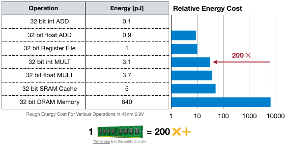<br>
*Source:* [\[Horowitz, M., 2014\]](https://gwern.net/doc/cs/hardware/2014-horowitz-2.pdf)

>[!NOTE]
> To make Deep Learning more efficient, we want to reduce the model size and the activation size to meaningfully drive down the amount of model-occupied memory, saving us time and energy.

## Introduction to Pruning

### What is Pruning?

Pruning actually is a deeply biological process witnessed in brain development over, e.g., a human lifespan:

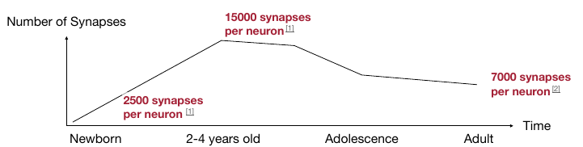<br>
*Source:* [\[Drachman, D.A., 2004\]](https://www.neurology.org/doi/10.1212/01.WNL.0000166914.38327.BB), [\[Walsh, C. A., 2013\]](https://pubmed.ncbi.nlm.nih.gov/24108045/)

This principle of consolidating neural capacities into reduced sets of neurons can be applied to deep learning.<br>
**In Deep Learning, pruning deliberately turns off parts of the neural network to reduce memory and compute costs.**

This is done by "plucking out and switching off" parts of the neural network in such a way that the loss accumulated by the pruned model remains as low as possible still.

Where the original model with weights $W$ and input $x$ follows the objective
$$\arg \min_{W} L(\textbf{x};\ \textbf{W})$$
the network with its now pruned weights $W_P$ simply does the same:
$$\arg \min_{W_P} L(\textbf{x};\ \textbf{W}_P)$$
but, crucially, under the constraint that the amount of active, non-zero weights inside $W_P$ meets or undercuts our target for the amount of non-zero weights retained, expressed through $N$: $||W_P||_0 \leq N$.

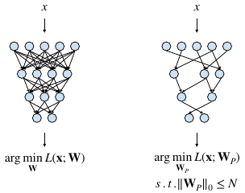

*The pruned neural network often is refered to as a sparse neural network.*<br>
Note that in this very generalized setting, we assume a weight to become inactive / unimpactful when we set it to $0$.

Intuitively, when training a full-size neural network and then removing those parts of it that we say contain the least information, one would expect the resulting pruned network to be much more volatile and incapable.

However, *this is actually not the case:*<br>
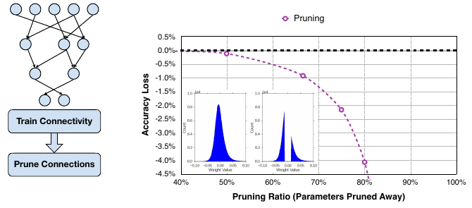<br>
*Source:* [\[Han et al., 2015\]](https://arxiv.org/abs/1506.02626)

The blue graphs are the weight distributions of the full network (left graph) and the pruned network (right graph). These graphs would suggest significant incapacitation, but as the trend of the larger pruning graph suggests that *pruning away $\sim 50\%$ of the network's weights has minimal effect on the remaining model's accuracy.* Note that we only 'incapacitated' weights with a value already near zero.

Truth be told, for this example, pruning beyond the $50\%$ weight threshold has accuracy diminish increasingly harshly.<br>
One way of pushing the pruning threshold further, though, consists of finetuning the remaining weights after pruning.<br>
This can be understood as redistributing the weight representations to `'make do with what weights remain'`.

For this example, finetuning the 'surviving' weights affords to prune $80\%$ of all weights without loss in accuracy. Moreover, *at $\sim 67\%$ pruning ratio, where before we'd see diminishing returns, accuracy now improves beyond the baseline.*

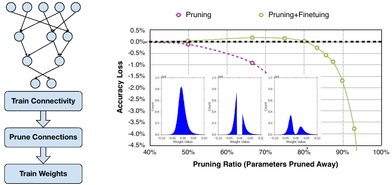<br>
*Source:* [\[Han et al., 2015\]](https://arxiv.org/abs/1506.02626)

The third blue graph illustrates the effect of the finetuning: Exposing the remaining weights to finetuning serves to *re-organize the weight distributions in a more purpose-driven way.* Remaining weights adapt to the circumstances, so to say.

**We can further push the pruning ratio,** for this network up to $\sim 90\%$, by *repeatedly cycling through pruning and finetuning.* With each iteration, iterative pruning gradually increases the target sparsity.

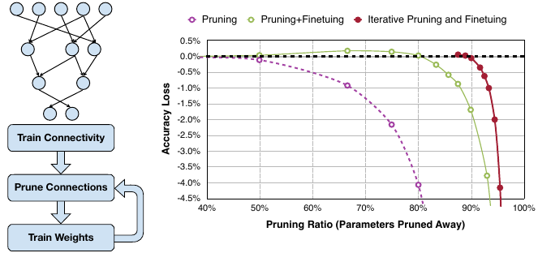<br>
*Source:* [\[Han et al., 2015\]](https://arxiv.org/abs/1506.02626)

>[!NOTE]
> Different neural networks, built and trained using different objectives and architectures, will react differently to purning efforts. Different thresholds may apply.
> The degree to which pruning affects the $\text{Number of Parameters}$ and MACs is inherently network-specific.

We can see this when comparing the outcomes of pruning efforts for different example models:

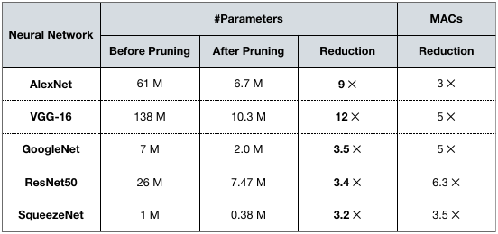<br>
*Source:* [Efficient Methods and Hardware for Deep Learning \[Han S., Thesis, Stanford University\]](https://stacks.stanford.edu/file/druid:qf934gh3708/EFFICIENT%20METHODS%20AND%20HARDWARE%20FOR%20DEEP%20LEARNING-augmented.pdf)

## Determining the Pruning Granularity

Pruning can be performed with different granularities, from **structured** to **unstructured.**<br>
The above table showed results for *unstructured* pruning efforts.<br>
We can nicely compare the two techniques with 2D matrices:

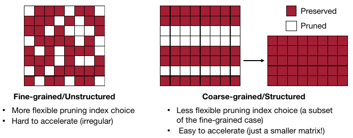

Where the *unstructured* approach can be more fine-grained and flexible in its selection of the specific weights to be 'switched off',  the *matrix structure that remains can still be hard to compress in memory*.
The pruning, in good intention, introduced structural irrelgularities into the weight matrix, which are hard for a GPU to parallelize.

However, with the *structured* pruning approach, giving up some flexibility and quality in weight selection affords us to be able to significiantly *reshape the weight matrix for easier acceleration.*

>[!NOTE]
> The unstructured pruning approach affords us a higher achievable pruning ratio and pruning quality.
> The achievable speed and efficiency increase, on the other hand, is higher with the structured pruning approach.

This is where *pruning granularity* comes into play.<br>
As discussed in the last lecture, the standard convolutional layer has four describing dimensions:
- $c_i,\ c_o$ : The input and output channel counts
- $k_h,\ k_w$ : The kernel height and width

Compared to the above example of the 2D matrix, the four dimensions of the convolutional layer provide us with more choices / freedom for selecting pruning granularities.<br>
Suppose a setup with $c_o=3$ different $3 \times 3$ kernels. Each kernel has a shape of $(c_i,\ k_h,\ k_w) = (2, 3, 3)$. This setup produces $c_o$ many output channels.

What is shown below is not $6$ different $(1,\ 3,\ 3)$ kernels, but one $(2, 3, 3)$ kernel per row, kind of like the 'layers making up a kernel'.<br>
And, for each layer, we now see which of the weights of that layer we may preserve or prune.

Unstructured pruning may now look like this:

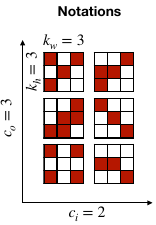<br>
*Source:* [\[Mao et al., 2017\]](https://openaccess.thecvf.com/content_cvpr_2017_workshops/w29/papers/Mao_Exploring_the_Granularity_CVPR_2017_paper.pdf)

Different techniques may place differently on the *unstructured vs. structured* spectrum of techniques:

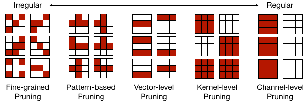<br>
*Source:* [\[Mao et al., 2017\]](https://openaccess.thecvf.com/content_cvpr_2017_workshops/w29/papers/Mao_Exploring_the_Granularity_CVPR_2017_paper.pdf)

| Technique                           | Pros                                                                                                             | Cons                                                                                                                 |
| ----------------------------------- | ---------------------------------------------------------------------------------------------------------------- | -------------------------------------------------------------------------------------------------------------------- |
| Unstructured / Fine-Grained Pruning | Offers the **highest pruning ratios through the highest flexibility** for selecting weights to be pruned.        | Performs worse than structrured approaches in terms of acceleration and parrallelizability.                          |
| Pattern-based Pruning               | Provides more regularity through applying pre-defined patterns, improved acceleration over unstructured approach | Imposing defined patterns can give away some of the resulting model's accuracy, compared to unstructured approaches. |

### Pattern-Based Pruning: N:M Sparsity

Pattern-based pruning may stand out. It sounds weird, just applying some preconceived notion of a pattern, rotating that across layers of the kernel, and that is supposed to have an effect. Admittedly, this may initially feel like astrology for convolutional layer optimization.

To convince you of the opposite, suppose we have a dense weight matrix that we want to prune.
$N:M$ sparsity, a kind of pattern-based pruning approach, states that of each $M$ contiguous elements, $N$ get pruned.

A standard case for this is 2:4 sparsity ($50\%$ pruning):<br>
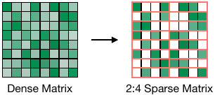<br>
*Source:* [developer.nvidia.com](https://developer.nvidia.com/blog/accelerating-inference-with-sparsity-using-ampere-and-tensorrt/)

While this is a preconceived pattern, it effectively distributes pruning efforts more evenly onto groups of four from across the entire dense matrix. This grouping abstraction we impose can indeed become very handy.<br>
Looking at the 2:4 sparse matrix, one might think that this looks like just another unstructured pruning result.<br>
But actually, our applied pattern can now enable more cost-effective compression:<br>
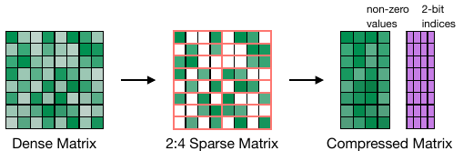<br>
*Source:* [developer.nvidia.com](https://developer.nvidia.com/blog/accelerating-inference-with-sparsity-using-ampere-and-tensorrt/)

For each value in the compressed matrix, its position maps to a subgroup, i.e. four possible locations in the sparse matrix. The exact location within each subgroup can then be encoded using 2 bits per non-zero value. *This technique is supported by NVIDIA's Ampere GPU architecture, where it can deliver up to 2x speed up.*

This $N:M$ pattern approach, specifically the 2:4 configuration, pretty much maintains the original model accuracy across different architectures and training objectives in Computer Vision:<br>
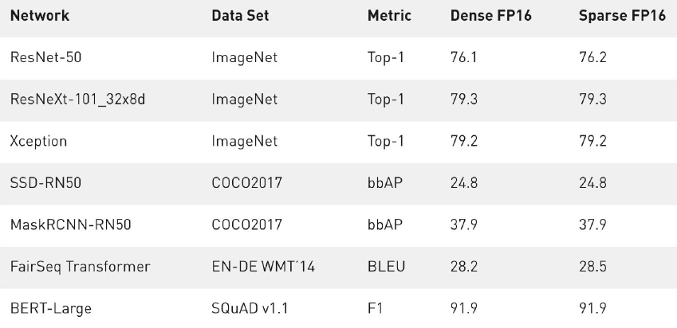<br>
*Source:* [developer.nvidia.com](https://developer.nvidia.com/blog/accelerating-inference-with-sparsity-using-ampere-and-tensorrt/)

### Channel-level Pruning

Skipping from the irregular to the regular side of the spectrum of pruning approaches for CNNs, channel-level pruning removes entire kernel channels at once.

See the leftmost visualization:<br>
<br>
*Source:* [\[Mao et al., 2017\]](https://openaccess.thecvf.com/content_cvpr_2017_workshops/w29/papers/Mao_Exploring_the_Granularity_CVPR_2017_paper.pdf)

This brings a pretty direct speedup, as a smaller kernel requires less operations for information to pass through to the next layer.<br>
No specialized hardware scheme (like with N:M sparsity in pattern-based pruning) needed. 

Channel Pruning's structured approach leaves us not much room to 'pick the best weight candidates for removal'. We do not have to prune the same amount of channels across all layers.<br>
*The sparsity with respect to how many channels get pruned can either be fixed (uniform shrinking) or layer-specific.*<br>
Both require us to find suitable thresholds for applicable sparsities.

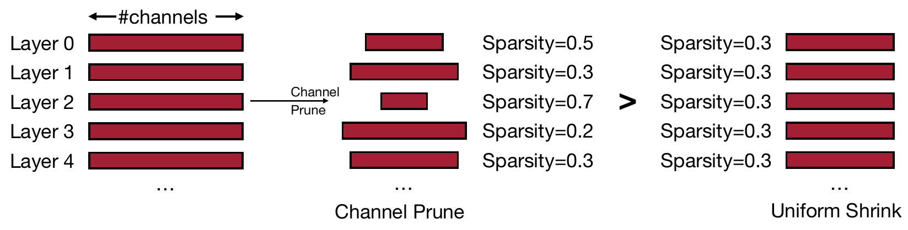<br>
*Source:* [\[He et al., 2018\]](https://openaccess.thecvf.com/content_ECCV_2018/html/Yihui_He_AMC_Automated_Model_ECCV_2018_paper.html)

>[!NOTE]
> Layer-wise channel pruning achieves a better accuracy-latency trade-off than uniform shrinking.
> It is therefore valuable to be able to identify an appropriate per-layer sparsity that preserves accuracy.
> Approaches like [AMC (AutoML for model compression)](https://arxiv.org/abs/1802.03494) exist.

## Determining the Pruning Criterion

For pruning to work, we need to be able to reliably identify and then remove the *least important neurons with respect to their contribution to model accuracy.*
**But how can we identify them?**

### Magnitude-based Pruning

This is probably the most intuitive approach to pruning: According to this criterion, *weights with larger absolute values are to be considered more important* than other weights.<br>
Therefore, the smallest weights become candidates for pruning.

*Applying this element-wise* to a $2 \times 2$ kernel with $50\%$ sparsity yields the pruned weight matrix:<br>
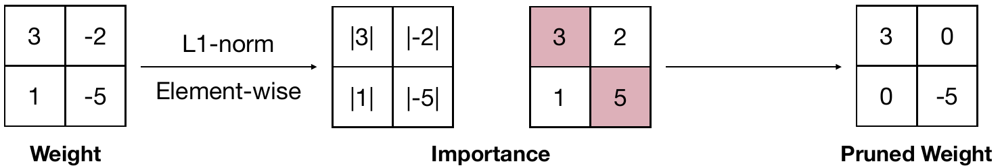<br>
*Source:* [\[Han et al., 2015\]](https://arxiv.org/abs/1506.02626)

*Applying this row-wise* for the same kernel with same target sparsity produces this weight matrix:<br>
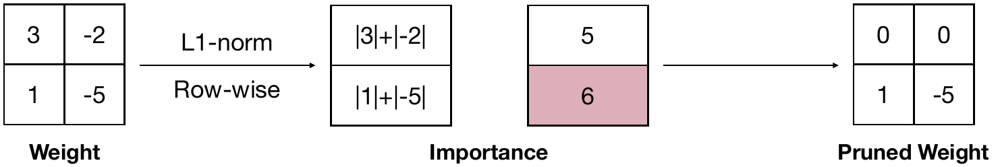<br>
*Source:* [\[Han et al., 2015\]](https://arxiv.org/abs/1506.02626)

*Applying this row-wise* but using the L2-Norm now yields:<br>
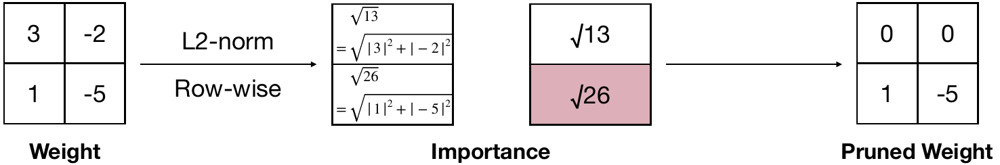<br>
*Source:* [\[Han et al., 2015\]](https://arxiv.org/abs/1506.02626)

This can be generalized to any $L_p$ -norm:

$$||W^{(S)}||_p = \left( \sum_{i \in S} |w_i|^p \right)^{\frac{1}{p}}$$

where $W^{(S)}$ is a subset of weights and $p$ controls how importance is measured.
Larger values indicate more important groups of $S$ many weights.

### Scaling-based Pruning

Suppose we have $N$ many kernels. A *scaling factor* is associated with each kernel (meaning one factor affects one output channel of the convolutional layer). *These kernel-wise scaling factors themselves are trainable.*

The objective for these scaling factors is for them to become as small as possible while retaining accuracy. Once such factors are established, their *magnitude indicates which output channels can actually be pruned.* The smaller the factor, the less the channel contributes to the output, the more likely it is to be removable without (substantial) loss of model capability. 

Hence, in the below image, $\text{Filter 1}$ is a candidate for pruning, while $\text{Filter 0}$ should remain unchanged:<br>
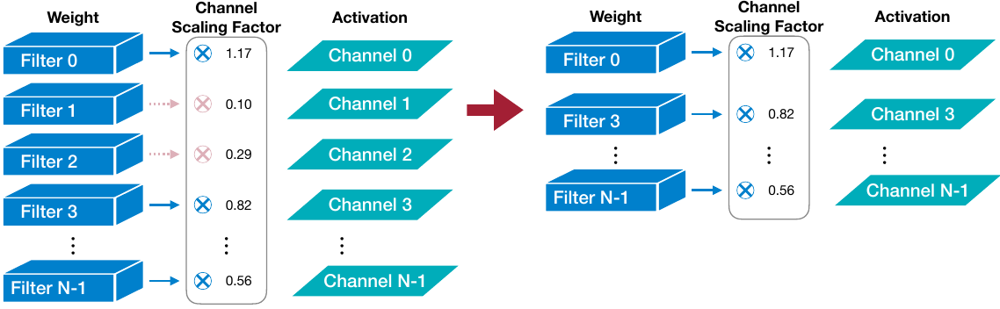<br>
*Source:* [\[Liu et al., 2017\]](https://arxiv.org/abs/1708.06519)

If a filter is followed by batch normalization, there is no need for an extra scaling factor. The batch norm parameter $\gamma$ represents this information already. With batch-normalization, you have one scaling factor per channel, which is exactly the resolution we need for our scaling-based pruning.

>[!CAUTION]
>**Question:** I do not understand how batch normalization provides one scaling factor per channel. Doesn't it operate on batch-level, as the name would suggest?

>[!TIP]
>**Anwer:** With batch normalization, *mean and variance are computed per channel across the batch*.
>The learnable parameters $\gamma$ (scale) and $\beta$ (shift) are *one per channel*, not per batch, meaning that for each output channel $c$, batch norm calculates $y_c = \gamma_c \cdot x_c + \beta_c$.
>Batch normalization indeed normalizes across the batch strictly channel-wise, hence $\gamma$ expresses the channel-wise importance of contribution to the normalized result, therefore perfectly working as a stand-in for our scaling factor for pruning.

### Second-Order-based Pruning

The loss $L$ is a smooth function of the weights. We observe it at two distinct points, weights $W$ and pruned weights $W_p$. Because of this observability at the two points, we can say that $L$ can be approximated by a Taylor series:

$$\delta L = L(\textbf{x};\textbf{W}) - L(\textbf{x}; \textbf{W}_p = \textbf{W} - \delta\textbf{W}) = \sum_i g_i\delta w_i + \frac{1}{2}\sum_i h_{ii}\delta w_i^2 + \frac{1}{2}\sum_{i \neq j} h_{ij}\delta w_i \delta w_j  + O(||\delta\textbf{W}||^3)$$

*This is a description of the difference in loss between the two network configurations, where:*
- $g_i$ expresses how sensitive the loss is to weight $w_i$, i.e. the gradient $\frac{\partial L}{\partial w_i}$
- $\delta w_i$ is the change made to weight $w_i$ (this can be $\delta w_i = w_i$ if the weight is removed entirely)
- $h_{ij}$ is the second derivatives' entry in the hessian matrix at $ij$, describing the interaction between weights $i$ and $j$
- The gradient represents the slope, the Hessian matrix represents the curvature

[This paper (Optimal Brain Damage \[LeCun et al., NeurIPS 1989\])](https://proceedings.neurips.cc/paper/1989/file/6c9882bbac1c7093bd25041881277658-Paper.pdf) now imposes three assumptions:
- The objective function $L$ is nearly quadratic, therefore the *last term can be neglected*
	- $L$ can be well expressed through just the first and second order derivatives
- The neural network training has converged in the models we compare here, so the *first-order-terms can be neglected*
	- As we already converged, the gradients at this stage should already be very close to zero, not having the term meaningfully contribute anyway
- As part of the second order term, the error caused by deleting each parameter is independent, so the *cross terms are neglected*
	- Removing one weight is assumed to not strongly affect other weights in their value
	- This induces the highest assumption-related inaccuracies

As a result, the paper simplifies the expression like so:

$$\delta L = L(\textbf{x};\textbf{W}) - L(\textbf{x}; \textbf{W}_p = \textbf{W} - \delta\textbf{W}\ |\ w_i = 0) = \underbrace{\sum_i g_i\delta w_i}_{\text{removed}} + \frac{1}{2}\sum_i h_{ii}\delta w_i^2 + \underbrace{\frac{1}{2}\sum_{i \neq j} h_{ij}\delta w_i \delta w_j}_{\text{removed}}  + \underbrace{O(||\delta\textbf{W}||^3)}_{\text{removed}}$$

>[!NOTE]
> According to this simplification, the increase in loss induced by pruning / removing weights depends on how big the change to the weight is ($\delta w_i$) *and* how important that weight is ($h_{ii}$).

The problem is that *the Hessian matrix* $H$, *which captures second-order sensitivity of the loss with respect to the weights  and relationships between them, is hard to compute.* We need to estimate it instead.

### Selecting Neurons to Prune

Up until now, we focused on selecting and then pruning distinct weights. Neurons can be pruned, too.<br>
As a neuron has multiple incoming and outgoing connections, each having their own weight, *pruning neurons can be understood as a coarse-grained / structured weight pruning.*

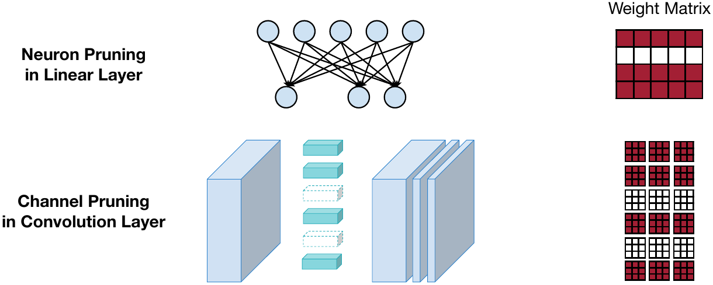<br>

The impact of removing a single neuron from the above network shows as a structured, row-wise removal of weights in the weight matrix. For kernels, the removal of distinct kernels shows in the kernel matrix as the removal of their distinct channel-wise weight matrices.

### Percentage-of-Zero-Based Pruning

If our network employs the ReLU activation, it can be utilized by another way to determine whether an activation should be removed or not.


By its nature, ReLU may set activations to zero if input values turned out to be anything but positive.

Suppose we have a batch of $n = 2$ many distinct output activations. **Not weights, but activations now.** Suppose each such output has $3$ channels (it was constructed using $3$ kernels), and each output has $h_o = 4,\ w_o = 4$, ReLU-activated.

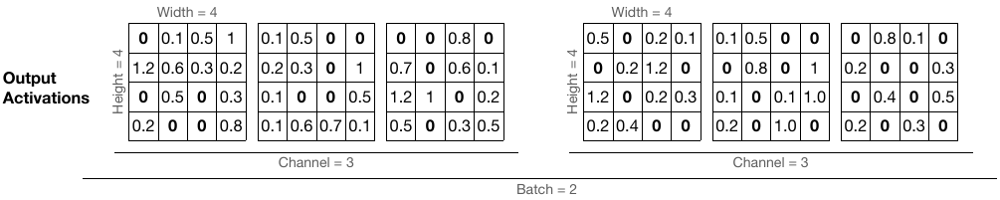<br>
*Source:* [\[Hu et al., 2017\]](https://arxiv.org/abs/1607.03250)

Now, per channel, the average percentage of produced zero activations can serve as heuristic for measuring the channel's importance. Based on that, we can decide to prune it.

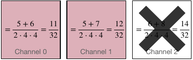<br>
*Source:* [\[Hu et al., 2017\]](https://arxiv.org/abs/1607.03250)

Per channel, across the batch, we sum up how many zero activations occur vs. how many neurons in total (all occurrences in the batch, again) this channel contributed. The larger the batch size for this, the better.

### Regression-based Pruning

Yet another approach to determine what to prune in a network. Suppose you want to prune a multi-billion parameter model.
Using the final output loss $L(\textbf{x};\ \textbf{W})$ would be inefficient, as you'd have to forward pass through the entire model.

>[!NOTE]
> Regression-based pruning minimizes reconstruction error, i.e. the difference between pruned and original layer outputs. It focuses only on the layer's matrix multiplication with the objective of minimizing output changes compared to the original.

Given these matrices for a CNN layer, one can see that *we can prune by removing processing of certain input channels while still maintaining the original output shape.*

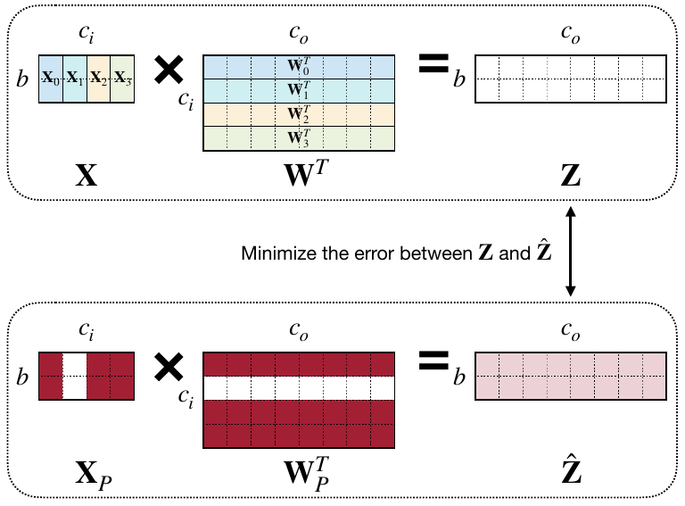<br>
*Source:* [\[He et al., 2017\]](https://arxiv.org/abs/1707.06168)

As the shape of the output remains the same, the objective now becomes to finetune in such a way that the reconstruction still produces the original output information as best as possible. *This step makes the optimization / pruning effort local.*

This can be formalized like so:

$$\arg \min_{W, \beta} ||\textbf{Z} - \hat{\textbf{Z}}||_F^2 = ||\textbf{Z} - \sum_{c=0}^{c_i - 1} \beta_c\textbf{X}_c\textbf{W}^T_c||^2_F$$

subject to

$$||\beta||_0 \leq N_c$$

The objective is to minimize the reconstruction error between the original output and the output produced by the pruned, input channel-wise scaled matrix multiplication. Input channel scaling is controlled by $\beta_c$, where, in our case, $\beta_c \in \{0,1\}$ indicates whether channel $c$ is pruned entirely or retained fully.<br>
We can only ever have as many $\beta$s as we have input channels, which is what the second statement establishes accordingly.

*You can now go and pursue either of two strategies:*
- Fix $\textbf{W}$ for an optimiziation round yielding a $\beta$ for channel selection from that $\textbf{W}$,
- Fix $\beta$ for an optimization round yielding finetuning of the remaining $\textbf{W}$

>[!NOTE]
> Layer-wise Pruning efforts make sense in especially large neural networks, like LLMs.
> Optimization can be done layer-wise and in parallel for arbitrary sets of layers.

## Fine-tune A Pruned Neural Network

This is a summary of the most important points of the "Pruning in PyTorch" Demo that was discussed at this point.<br>
An object of class `FineGrainedPruner` applies a finegrained / unstructured pruning approach to a convolutional neural network `model`:

```python
class Net(nn.Module):
        def __init__(self):
                super(Net, self).__init__()
                self.conv1 = nn.Conv2d(1, 32, 3, 1)  # 1 x 32 x 3 x 3 = 288 parameters
                self.conv2 = nn.Conv2d(32, 64, 3, 1) # 32 x 64 x 3 x 3=18,432 paramters
                self.dropout1 = nn.Dropout(0.25)
                self.dropout2 = nn.Dropout(0.5)
                self.fc1 = nn.Linear(9216, 128) # 9216 x 128 = 1,179,648 parameters
                self.fc2 = nn.Linear(128, 10)   # 128 x 10 = 1,280 parameters

        def forward(self, x):
                x = self.conv1(x)
                x = F.relu(x)
                x = self.conv2(x)
                x = F.relu(x)
                x = F.max_pool2d(x, 2)
                x = self.dropout1(x)
                x = torch.flatten(x, 1)
                x = self.fc1(x)
                x = F.relu(x)
                x = self.dropout2(x)
                x = self.fc2(x)
                output = F.log_softmax(x, dim=1)
                return output

model = Net().cuda()


class FineGrainedPruner:
    def __init__(self, model, sparsity_dict):
        self.masks = FineGrainedPruner.prune(model, sparsity_dict)

    @torch.no_grad()
    def apply(self, model):
        for name, param in model.named_parameters():
            if name in self.masks:
                param *= self.masks[name]

    def fine_grained_prune(self, tensor: torch.Tensor, sparsity : float) -> torch.Tensor:
        """
        magnitude-based pruning for single tensor
        :param tensor: torch.(cuda.)Tensor, weight of conv/fc layer
        :param sparsity: float, pruning sparsity
            sparsity = #zeros / #elements = 1 - #nonzeros / #elements
        :return:
            torch.(cuda.)Tensor, mask for zeros
        """
        sparsity = min(max(0.0, sparsity), 1.0)
        if sparsity == 1.0:
            tensor.zero_()
            return torch.zeros_like(tensor)
        elif sparsity == 0.0:
            return torch.ones_like(tensor)
        num_elements = tensor.numel()
        num_zeros = round(num_elements * sparsity)
        importance = tensor.abs()
        threshold = importance.view(-1).kthvalue(num_zeros).values
        mask = torch.gt(importance, threshold)
        tensor.mul_(mask)
        return mask

    @staticmethod
    @torch.no_grad()
    def prune(model, sparsity_dict):
        masks = dict()
        for name, param in model.named_parameters():
            if param.dim() > 1: # we only prune conv and fc weights
                if isinstance(sparsity_dict, dict):
                    masks[name] = self.fine_grained_prune(param, sparsity_dict[name])
                else:
                    assert(sparsity_dict < 1 and sparsity_dict >= 0)
                    if sparsity_dict > 0:
                        masks[name] = self.fine_grained_prune(param, sparsity_dict)
        return masks
``` 

```python
# Pretrain the CNN
lr = 1.0
lr_step_gamma = 0.7
num_epochs = 5

optimizer = Adadelta(model.parameters(), lr=lr)
criterion = F.nll_loss
scheduler = StepLR(optimizer, step_size=1, gamma=lr_step_gamma)

best_accuracy = 0
best_checkpoint = dict()

for epoch in range(num_epochs):
        train(model, dataloader['train'], criterion, optimizer, scheduler)
        accuracy = evaluate(model, dataloader['test'])
        is_best = accuracy > best_accuracy
        if is_best:
                best_checkpoint['state_dict'] = copy.deepcopy(model.state_dict())
                best_accuracy = accuracy
        print(f'     Epoch {epoch+1:>2d} Accuracy {accuracy:.2f}% / Best Accuracy: {best_accuracy:.2f}%')

print(f"=> loading best checkpoint")
model.load_state_dict(best_checkpoint['state_dict'])
recover_model = lambda: model.load_state_dict(best_checkpoint['state_dict'])
```

```python
# Prune away 99% of the weights
sparsity = 0.99

recover_model()
pruner = FineGrainedPruner(model, sparsity)
pruner.apply(model)

sparse_model_accuracy = evaluate(model, dataloader['test'])
sparse_model_size = get_model_size(model, count_nonzero_only=True)

print(f"{sparsity*100}% sparse model has accuracy={sparse_model_accuracy:.2f}%")
print(f"{sparsity*100}% sparse model has size={sparse_model_size/MiB:.2f} MiB, "
            f"which is {dense_model_size/sparse_model_size:.2f}X smaller than "
            f"the {dense_model_size/MiB:.2f} MiB dense model")

visualize(True)
```

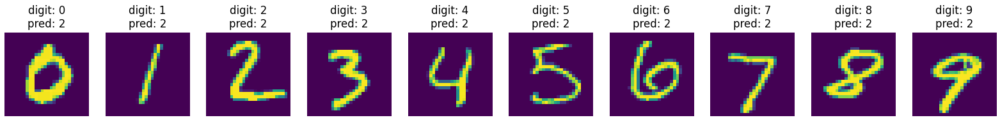

```python
# Finetune a 70% pruned model back to high accuracy
# 99% was too damaged, would have been unrecoverable, but 70% is still extreme
num_finetune_epochs = 2
optimizer = torch.optim.SGD(model.parameters(), lr=0.1, momentum=0.9, weight_decay=1e-4)
scheduler = torch.optim.lr_scheduler.CosineAnnealingLR(optimizer, num_finetune_epochs)

best_sparse_checkpoint = dict()
best_sparse_accuracy = 0

print(f'Finetuning Fine-grained Pruned Sparse Model')

for epoch in range(num_finetune_epochs):
        # At the end of each train iteration, we have to apply the pruning mask
        # to keep the model sparse during the training
        train(model, dataloader['train'], criterion, optimizer, scheduler,
                    callbacks=[lambda: pruner.apply(model)])
        accuracy = evaluate(model, dataloader['test'])
        is_best = accuracy > best_sparse_accuracy
        if is_best:
                best_sparse_checkpoint['state_dict'] = copy.deepcopy(model.state_dict())
                best_sparse_accuracy = accuracy
        print(f'     Epoch {epoch+1} Sparse Accuracy {accuracy:.2f}% / Best Sparse Accuracy: {best_sparse_accuracy:.2f}%')
        
model.load_state_dict(best_sparse_checkpoint['state_dict'])

sparse_model_accuracy = evaluate(model, dataloader['test'])
sparse_model_size = get_model_size(model, count_nonzero_only=True)

print(f"{sparsity*100}% sparse model has accuracy={sparse_model_accuracy:.2f}%")
print(f"{sparsity*100}% sparse model has size={sparse_model_size/MiB:.2f} MiB, "
            f"which is {dense_model_size/sparse_model_size:.2f}X smaller than "
            f"the {dense_model_size/MiB:.2f} MiB dense model")

visualize(True)
```

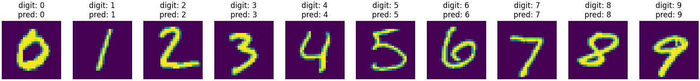

---

MLPerf is a benchmark. It tests the performance w.r.t. latency and throughput, given a particular accuracy on a suite of benchmarks.

- With the *closed division* of the benchmark, you cannot change the network itself, but you can apply quantization for efficiency gains
- With the *open division* of the benchmark, you can structurally adapt the model architecture itself, e.g., via pruning and other techniques

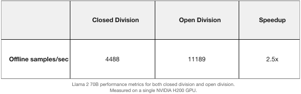<br>
*Source:* [developer.nvidia.com](https://developer.nvidia.com/blog/nvidia-blackwell-platform-sets-new-llm-inference-records-in-mlperf-inference-v4-1/)

As it turns out, layering different techniques actually works in pushing model size into extremely small regimes while retaining accuracy. This more so works than, e.g. taking just one measure, like pruning, and pushing that to an extreme.<br>
**It is balance between different measures that works best:**

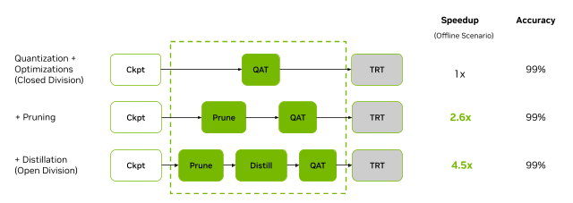<br>
*Source:* [developer.nvidia.com](https://developer.nvidia.com/blog/leading-mlperf-inference-v3-1-results-gh200-grace-hopper-superchip-debut/)

---

<p align="center">
      Notes by <a href="https://github.com/MK2112">MK2112</a>
</p>
